# 🔥 Growlithe — Time 26

> **Integrantes:** Bruno Reis Mendes · Jhuan Pablo Noleto Cardoso · Ricardo Silva Freitas · Vithor Borges Ferreira Moura
>
> **Missões que fazem você voltar ao shopping.**
> Hackathon · Desafio **05. Engajamento e fidelização dos visitantes** · **Entrega 1: planejamento técnico inicial** (13/11, até 12h)

---

## 1. Nome do projeto e descrição (pitch)

**Growlithe** é um **web app gamificado, feito em React**, que transforma a visita ao shopping em uma jornada de missões, pontos e prêmios. Ele abre direto no navegador do celular, **sem instalar nada**.

### Contexto
O desafio é do **Shopping Capim Dourado** (Palmas, TO). Shopping centers deixaram de ser só lugares de compra: competem com o comércio online e com outras opções de lazer pela atenção e pelo tempo das pessoas. Para continuar relevante, o shopping precisa criar um **relacionamento contínuo com o visitante**, um motivo para ele voltar, circular por mais lojas e ficar mais tempo. Ao mesmo tempo, quase todo visitante já anda com um celular com câmera e internet, e o QR Code virou um hábito no Brasil (Pix, cardápios, cupons fiscais).

### Problemática
- A visita é **transacional**: a pessoa entra, compra o que precisava e vai embora, sem motivo concreto para voltar.
- O shopping **não conhece o visitante**: não sabe quem veio, com que frequência, nem quais ações funcionam.
- Os programas de fidelidade tradicionais (cadastrar nota fiscal, cartão de pontos) **dão trabalho** e só recompensam quem já gasta muito.
- Soluções em **aplicativo para instalar têm baixo alcance**: poucas pessoas baixam um app só para ganhar um benefício no shopping.
- Lojistas de alas menos movimentadas **não recebem fluxo** de pessoas.

### Justificativa
Gamificação (missões, níveis, sequências e recompensas) é uma forma comprovada de criar hábito e retorno, como mostram apps como Duolingo e Strava. Entregar isso como **web app aberto por QR Code** elimina a barreira da instalação e alcança qualquer visitante com celular. Validar compras pelo **QR Code do cupom fiscal**, que toda loja já emite, permite recompensar a compra **sem integração com os sistemas dos lojistas**, o que torna a solução viável e barata de implantar desde o primeiro dia. Para o shopping, cada scan vira dado de circulação e de retorno, que hoje ele não tem.

### Objetivo geral
Desenvolver um web app gamificado que **aumente o engajamento e a fidelização dos visitantes** do shopping, criando um relacionamento contínuo por meio de missões, pontos, níveis e recompensas reais.

### Objetivos específicos
1. Permitir que o visitante acesse a solução **pela câmera do celular, sem instalar aplicativo**.
2. Implementar **missões por QR Code**: check-in, caça ao tesouro, sequência de visitas e eventos.
3. Implementar a **Missão Relâmpago**, com validação da compra pelo **QR Code do cupom fiscal (NFC-e)**.
4. Criar o sistema de **pontos, níveis e resgate de prêmios**, com validação pelo lojista.
5. Oferecer ao shopping um **painel** para criar missões e acompanhar circulação, retorno e resultados.
6. Validar o interesse do público com uma **landing page** com lista de espera, teste A/B e métricas de conversão.
7. Garantir **segurança e LGPD**: QR Codes assinados, cupom de uso único e nenhum armazenamento de CPF.

### Proposta de solução
O visitante **aponta a câmera do celular para um QR Code** espalhado pelo shopping e já está jogando:

- **Missões:** check-in na entrada, caça ao tesouro com QR Codes em ordem, sequência de visitas e check-in em eventos.
- **⚡ Missão Relâmpago:** desafio surpresa e genérico, como *"compre uma peça de roupa em qualquer loja até as 18h e ganhe pontos em dobro"*. A compra é validada pelo **QR Code do cupom fiscal (NFC-e)**, que toda loja já imprime, **sem integração com os lojistas**.
- **Pontos e níveis:** Bronze → Prata → Ouro → Diamante.
- **Prêmios reais:** estacionamento grátis, descontos nas lojas e experiências, resgatados com um código de 6 dígitos que o lojista valida.
- **Painel do shopping:** criar missões, lançar Missões Relâmpago por notificação e acompanhar circulação e resultados.

**Ganha o visitante** (diversão e benefícios), **o lojista** (gente na porta e venda) e **o shopping** (relacionamento contínuo e dados de circulação).

➜ Visão completa, personas e métricas: [`docs/02-visao-do-produto.md`](docs/02-visao-do-produto.md)

---

## 2. Grupo e integrantes

**Time 26 — Growlithe**

| Integrante | Papel |
|---|---|
| Bruno Reis Mendes | _a definir_ |
| Jhuan Pablo Noleto Cardoso | _a definir_ |
| Ricardo Silva Freitas | _a definir_ |
| Vithor Borges Ferreira Moura | _a definir_ |

---

## 3. Linguagem, plataforma e tecnologias

| Camada | Escolha | Por quê |
|---|---|---|
| **Linguagem** | **TypeScript** (modo `strict`) | Uma linguagem só no front e no back; erros aparecem na hora de compilar, não na demo |
| **Interface** | **React** com o framework **Next.js** | Biblioteca de interface mais usada no mercado; o time já conhece JavaScript |
| **Plataforma** | **Web app** no navegador do celular | Sem instalação (maior alcance, orientação do mentor); um código só para Android e iPhone |
| Estilo | Tailwind CSS + shadcn/ui | Componentes acessíveis e rápidos de montar |
| Validação e tipos | Zod | Um schema gera o tipo TypeScript e valida os dados reais (formulários, QR Codes, banco) |
| Banco e login | Supabase (Postgres, Auth, Realtime) | Banco gerenciado, login por link mágico e atualização em tempo real |
| Cupom fiscal | API Infosimples (SEFAZ / NFC-e) | Confere data, valor e itens da compra; se a consulta cair, valida localmente pela chave do QR |
| Hospedagem | Vercel | Deploy a cada push e link de preview para cada mudança |
| Processo | GitHub + GitHub Actions + skills do Matt Pocock | Spec-driven development (grill me → spec → implement) e CI em todo PR |

**Identidade visual:** dois temas. **Escuro** em vermelho `#FF422A`, preto e branco; **claro** com as cores da bandeira do Tocantins (azul `#1B47B4`, branco e amarelo `#FDD700`). O app segue o modo do celular. Todos os pares de texto passam no contraste AA ([`src/ui/theme.ts`](src/ui/theme.ts)).

➜ Detalhes: [`docs/04-linguagem.md`](docs/04-linguagem.md) · [`docs/06-stack.md`](docs/06-stack.md) · [`docs/09-integracao-sefaz.md`](docs/09-integracao-sefaz.md) · [`docs/10-processo-de-desenvolvimento.md`](docs/10-processo-de-desenvolvimento.md)

---

## 4. Arquitetura proposta

**Monólito modular em React/Next.js**: um único projeto e um único deploy reúnem o web app do visitante, o painel do shopping e a landing page. Todos compartilham o mesmo **modelo de domínio tipado** ([`src/domain/schemas.ts`](src/domain/schemas.ts)), então o front e o back nunca discordam sobre o formato dos dados.

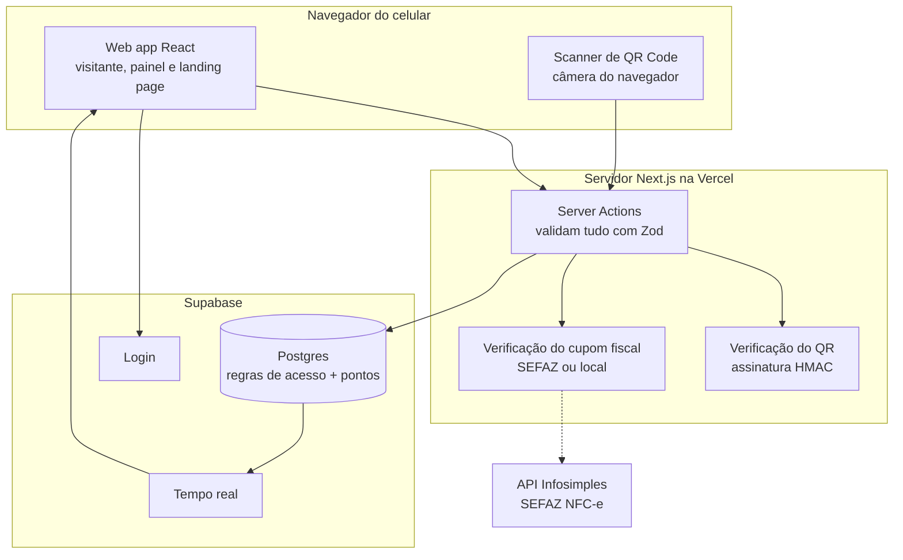

**Princípios:**
- **Toda entrada é validada na borda** (QR Code, formulário, resposta da SEFAZ, linha do banco) com Zod antes de chegar à regra de negócio.
- **Pontos só mudam no banco**, numa função transacional. Um mesmo QR ou cupom nunca pontua duas vezes, nem com duas requisições ao mesmo tempo.
- **QR Codes assinados** (não dá para forjar) e cupom fiscal de **uso único** (antifraude).
- **Estados modelados para não existirem combinações inválidas** (por exemplo, um cupom "resgatado" sempre tem data de resgate). Isso é garantido pelo compilador e coberto por testes de tipo.
- **LGPD:** do cupom fiscal guardamos só loja, valor e horário; nunca o CPF.

➜ Diagramas de sequência, segurança e decisões: [`docs/05-arquitetura.md`](docs/05-arquitetura.md) · Modelo de dados: [`docs/03-modelo-de-dados.md`](docs/03-modelo-de-dados.md)

---

## 5. Tecnologia ou prática da roleta: **Landing Page**

Eixo sorteado: **Testes, métricas e lançamento → Landing page**.

A landing page do Growlithe é o **primeiro experimento do produto**: ela responde com dados se as pessoas querem a solução.

- **Três públicos, três chamadas:** visitante ("Entrar na lista de espera"), lojista ("Quero minha loja no Growlithe") e shopping ("Agendar demonstração"), todos no mesmo formulário com validação Zod e aceite da LGPD.
- **Mesmo projeto React** do app, na rota `/`, com o mesmo visual e os mesmos componentes.
- **Teste A/B de manchete:** A: *"Seu passeio no shopping agora vale prêmios."* × B: *"Ganhe estacionamento grátis só por passear."*
- **Métricas:** taxa de conversão (meta > 15%), conversão por público, origem dos cadastros (UTM), cliques e rolagem, tempo de carregamento.
- **QR Code de novo:** cartazes no shopping e o slide do pitch levam à landing page com UTM, para medir qual ponto físico traz mais cadastros. **Na apresentação, a banca escaneia o QR do slide e se cadastra ao vivo.**

➜ Detalhes: [`docs/07-pratica-sorteada-landing-page.md`](docs/07-pratica-sorteada-landing-page.md)

---

## 6. Proposta e estrutura inicial das telas

Wireframes de alta fidelidade salvos em [`docs/wireframes/`](docs/wireframes/), nos dois temas. Há também o **protótipo navegável** em [canvas de design](https://claude.ai/artifact/8nLcM6mxjsQEm2uV5QB1ae). A estrutura é inicial e vai evoluir durante o hackathon.

**Fluxo principal:** Home → Missão Relâmpago → Scanner → Resultado → Prêmios → Cupom de resgate.

### Tema escuro

| Home | Missões | Scanner | Resultado do scan |
|---|---|---|---|
| 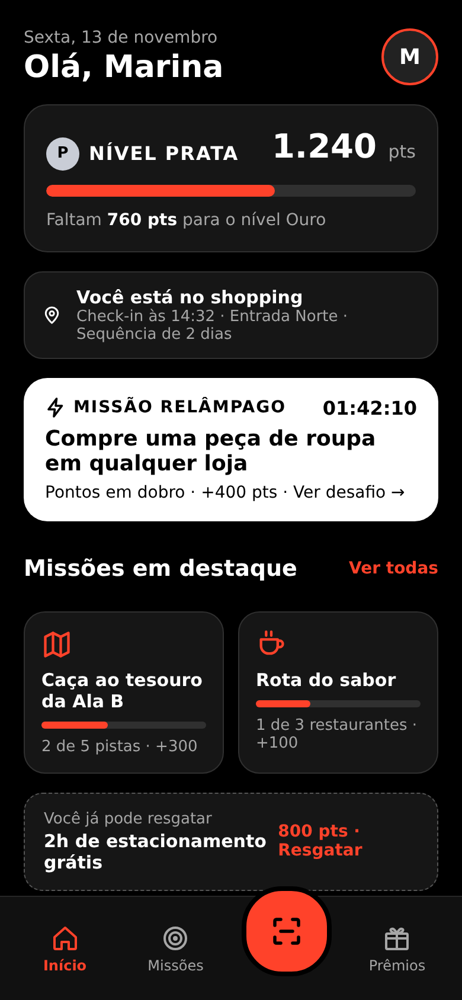 | 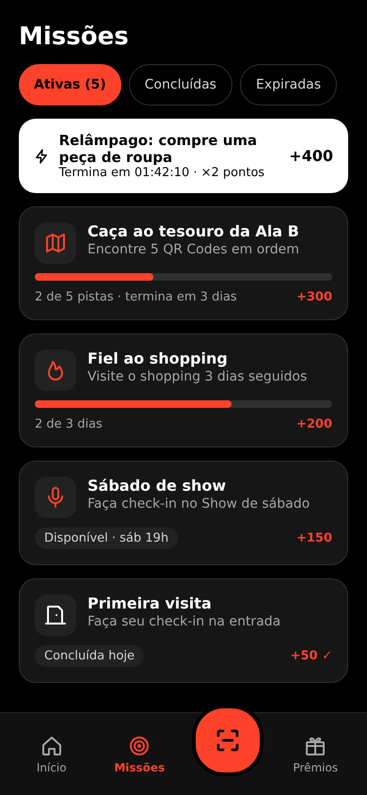 | 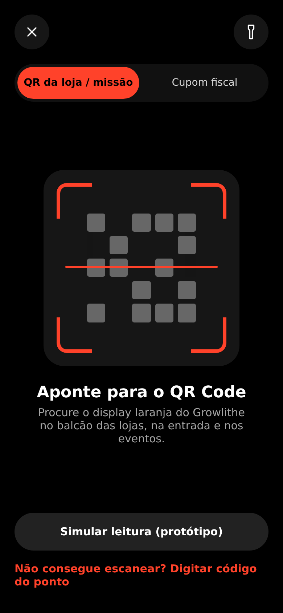 | 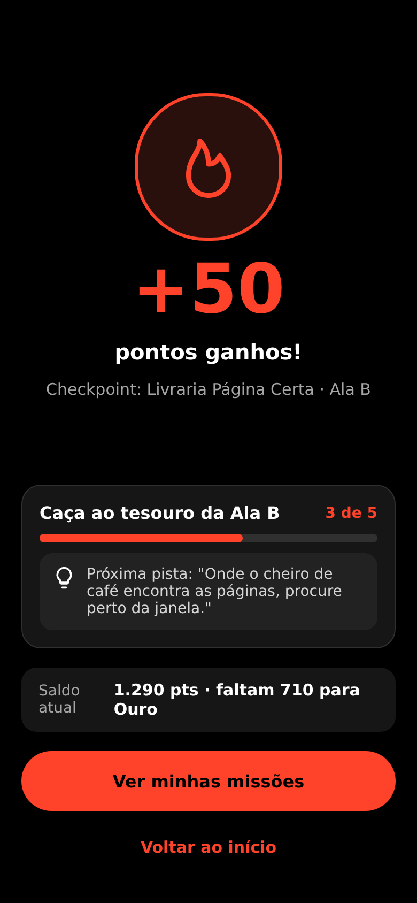 |

| Missão Relâmpago | Prêmios | Cupom de resgate |
|---|---|---|
| 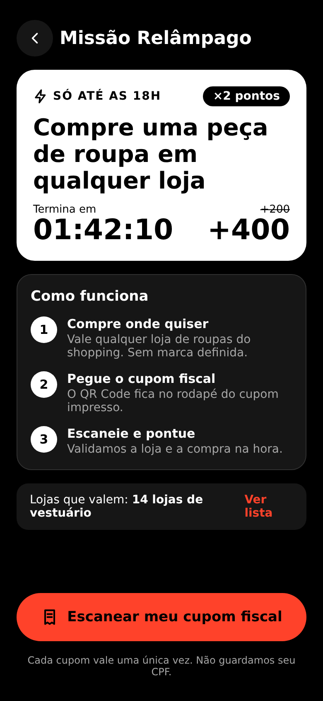 | 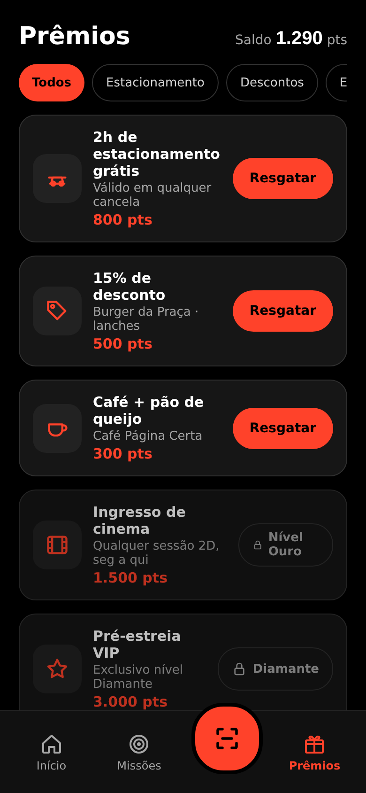 | 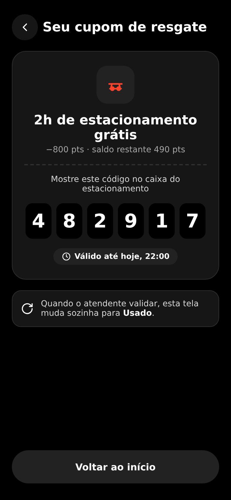 |

### Tema claro (cores do Tocantins)

| Home | Missões | Scanner | Resultado do scan |
|---|---|---|---|
| 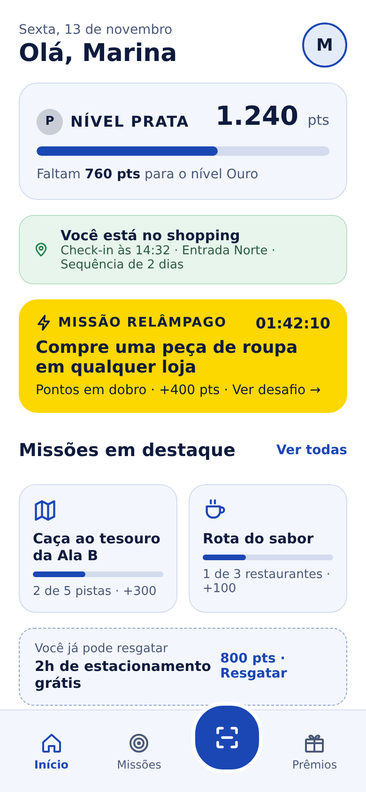 | 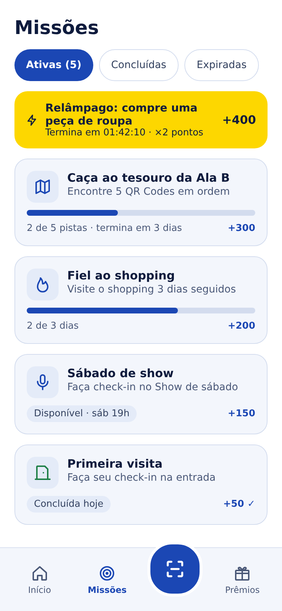 | 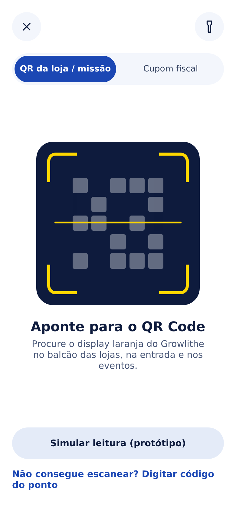 | 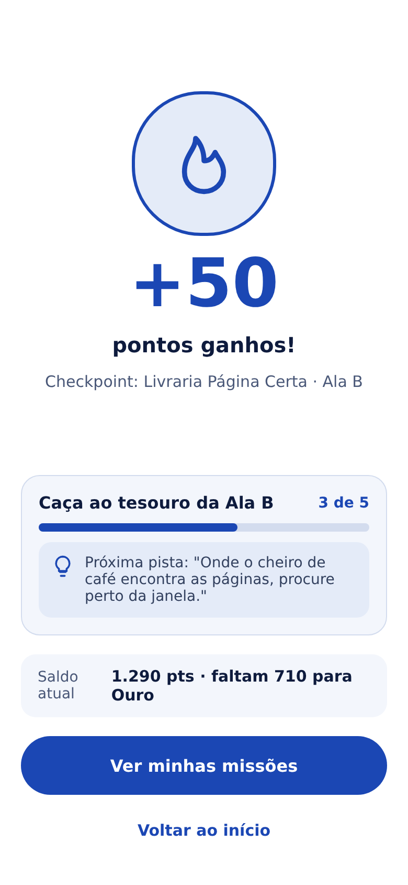 |

| Missão Relâmpago | Prêmios | Cupom de resgate |
|---|---|---|
| 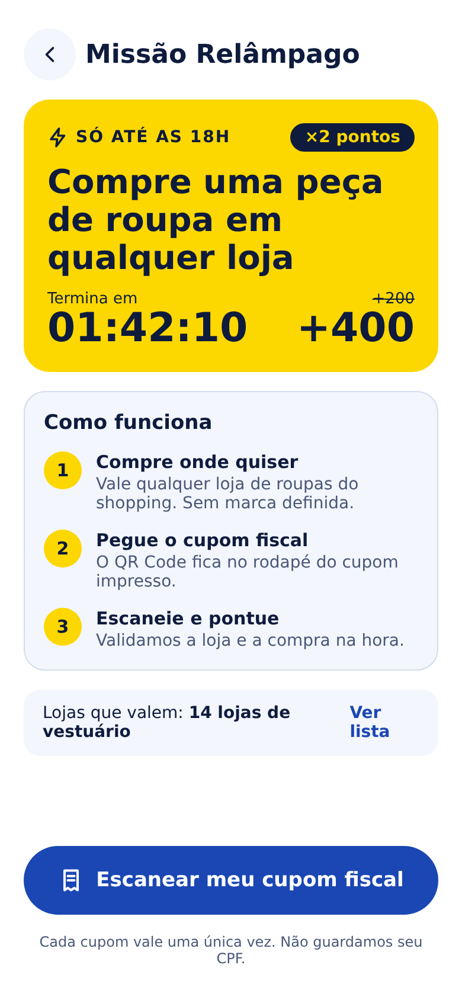 | 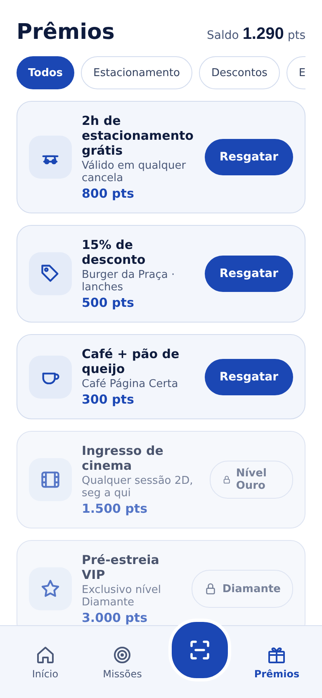 | 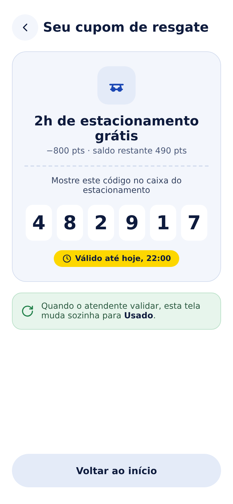 |

### Landing page

[Tema escuro](docs/wireframes/tema-escuro/09-landing-page.png) · [Tema claro](docs/wireframes/tema-claro/09-landing-page.png)

➜ Mapa de telas, fluxos e wireframes em texto (incluindo o painel admin): [`docs/01-telas-e-fluxos.md`](docs/01-telas-e-fluxos.md)

---

## Estrutura do repositório

```
growlithe/
├── README.md                     # esta documentação inicial
├── CONTEXT.md                    # glossário do domínio
├── CLAUDE.md                     # regras do fluxo spec-driven para agentes
├── docs/
│   ├── 01-telas-e-fluxos.md      # mapa de telas, fluxos, wireframes em texto
│   ├── 02-visao-do-produto.md    # problema, personas, escopo do MVP, métricas
│   ├── 03-modelo-de-dados.md     # schemas Zod, tabelas, máquinas de estado
│   ├── 04-linguagem.md           # por que TypeScript + React
│   ├── 05-arquitetura.md         # diagramas e decisões
│   ├── 06-stack.md               # plataforma e bibliotecas
│   ├── 07-pratica-sorteada-landing-page.md
│   ├── 08-qr-code-e-gamificacao.md
│   ├── 09-integracao-sefaz.md
│   ├── 10-processo-de-desenvolvimento.md
│   ├── 11-plano-entrega-final.md # prazos de 14/11, critérios e ordem de entrega
│   ├── specs/                    # 000-template · 001-missao-relampago · 002-landing-page · 003-painel-admin
│   └── wireframes/               # telas em PNG, tema escuro e claro
├── src/
│   ├── app/                      # Next.js: layout com os temas + landing page (rota /)
│   ├── middleware.ts             # teste A/B: fixa a variante da manchete por cookie
│   ├── landing/ab-test.ts        # manchetes A/B e sorteio
│   ├── domain/schemas.ts         # modelo de domínio (Zod), inclui papéis e checkpoints do painel
│   ├── domain/schemas.type-test.ts
│   ├── server/qr-token.ts        # assina e verifica o QR do checkpoint (HMAC)
│   ├── server/receipt-verifier.ts# cupom fiscal: SEFAZ + fallback local
│   └── ui/theme.ts               # temas escuro e claro
├── supabase/
│   ├── migrations/               # tabelas, papéis e RLS do painel
│   ├── seed.sql                  # lojas, checkpoints e recompensas de demonstração
│   └── tests/                    # testes de banco (RLS) num Postgres temporário
├── .github/
│   ├── workflows/ci.yml          # tipos, lint, testes, build e banco em todo PR
│   └── pull_request_template.md  # PR exige spec, ticket e critérios de aceite
├── package.json · tsconfig.json · eslint.config.mjs · vitest.config.ts · .env.example
```

## Status (13/11, noite)

> Prazo: **MVP rodando em 14/11 às 12h** e **pitch de 90s às 13h**. Ordem de entrega e critérios em [`docs/11-plano-entrega-final.md`](docs/11-plano-entrega-final.md). Toda feature passa pelo fluxo spec-driven ([`CLAUDE.md`](CLAUDE.md)).

**Pronto na `main`:**
- ✅ Projeto Next.js 15 + React 19 com TypeScript strict, Zod, Vitest, ESLint e CI verde.
- ✅ Landing page na rota `/` com os dois temas e teste A/B de manchete (spec 002, T1–T2).
- ✅ Spec 003 do painel: casos de uso, diagrama de classes, requisitos funcionais e não funcionais, critérios de aceite e 9 issues (#3–#11).
- ✅ Painel T1 (#3): schemas de papel, checkpoint, métricas e regra de validação do cupom de resgate.
- ✅ Painel T2 (#4): migration com tabelas, papéis, RLS e seed, com testes de banco no CI.
- ✅ Painel T4 (#6): assinatura e verificação HMAC do QR do checkpoint.
- ✅ Painel T3 (#5): login por link mágico, `/painel` por papel (admin, lojista, sem acesso) e `/auth/callback`.
- ✅ Projeto Supabase **growlithe** (`wmqymygwjppykjsejzah`, São Paulo) com a migration e o seed aplicados, RLS verificada no projeto real e advisors de segurança sem alertas.

### Onde paramos (retomar daqui)

Estado em **14/11, madrugada**: tudo na `main`, CI verde, banco Supabase com as 6 migrations aplicadas (mesmas versões do repositório).

**Pronto:**
- Landing com teste A/B, **lista de espera gravando leads** (spec 002) e passada de design (Impeccable).
- **App do visitante (spec 004):** `/s/<token>` (escaneou → pontos), `/app` (nível, saldo, presença, missões) e `/app/missoes`. O QR é assinado e conferido **dentro do banco** (o segredo nunca sai de lá).
- **Painel (spec 003):** login por papel, checkpoints e QR, **missões** (criar, listar, encerrar), **validar cupom de resgate** e **dashboard** (check-ins, visitantes, scans por checkpoint, missões, resgates e conversão do A/B).
- **Easter egg de sexta-feira 13 (spec 006):** mascote dormindo de 00h às 06h e chuva forte em Palmas. Na demo: `?easter=noite` e `?easter=chuva`.

**Roteiro da manhã (antes do pitch):**
1. **Supabase → Authentication → URL Configuration → Redirect URLs:** adicionar `http://localhost:3000/**` (e o endereço da Vercel).
2. `pnpm.cmd dev` → abrir `/painel` → pedir o link com o e-mail do admin → clicar no e-mail. Depois, no SQL Editor: `select private.grant_staff('<e-mail>', 'admin', null);` e recarregar.
3. No painel: **Checkpoints → Imprimir QR** da "Entrada principal" (é o check-in, vale 20 pts). Crie uma missão de teste em **Missões**.
4. No celular: escanear o QR → entrar com outro e-mail → informar o nome → ver os pontos. Abrir `/app`.
5. Conectar o repositório à **Vercel** e cadastrar `NEXT_PUBLIC_SUPABASE_URL` e `NEXT_PUBLIC_SUPABASE_ANON_KEY` (o `QR_SIGNING_SECRET` não é mais usado: o segredo vive no banco).
6. Gravar o pitch de 90s até 12h30 (roteiro em `docs/11-plano-entrega-final.md`).

**Decisões tomadas de madrugada, para revisar (⚠️ nas specs):** spec 004 D9–D15 (pontos base 10/20, caça ao tesouro fora de ordem, missão completa 1 vez, multiplicador relâmpago, nome no primeiro login, endereços, celebração de nível) e spec 006 D3–D7 (mascote original, Open-Meteo, limiar de chuva, card no lugar do mapa, `?easter=`).

**Pendente:** lista de e-mails de admin automática (falta saber os e-mails do time).

**Dados de teste no banco (limpar antes do pitch, se quiser números zerados no dashboard):** 1 lead do QA (`qa-growlithe@example.com`) e 3 visitas de teste da landing. No SQL Editor:
`delete from public.landing_leads where email = 'qa-growlithe@example.com'; delete from public.landing_visits;`

**Em outro computador:** `git clone`, `pnpm install` e criar o `.env.local` com `NEXT_PUBLIC_SUPABASE_URL=https://wmqymygwjppykjsejzah.supabase.co` e `NEXT_PUBLIC_SUPABASE_ANON_KEY` (chave *publishable* em *Project Settings → API keys*).
