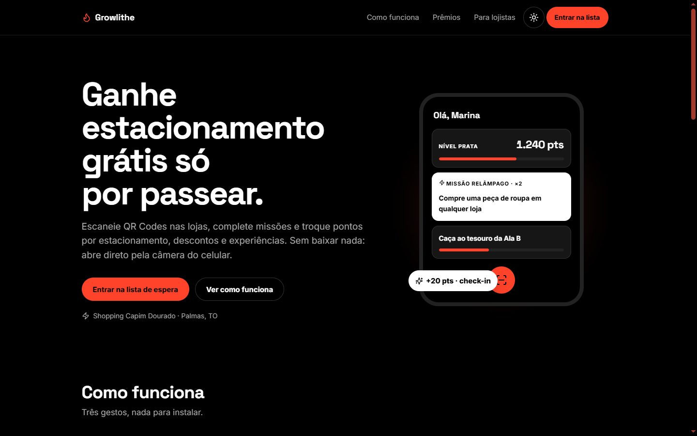
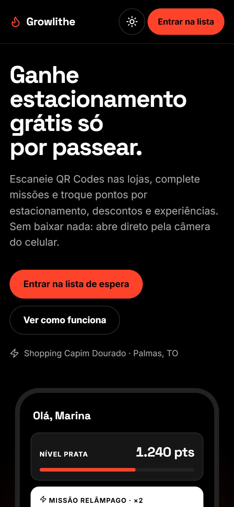
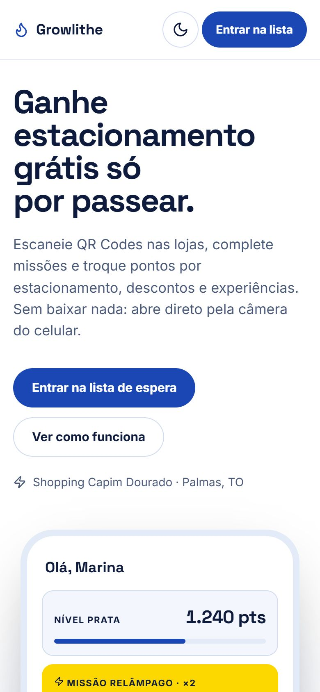
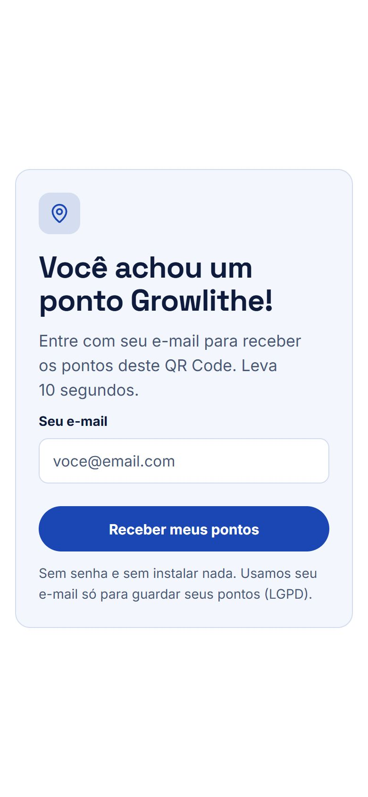
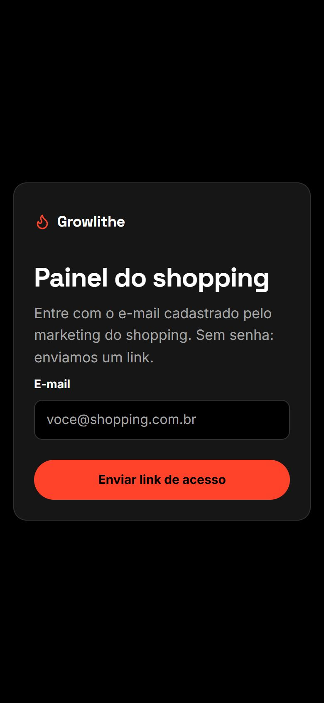
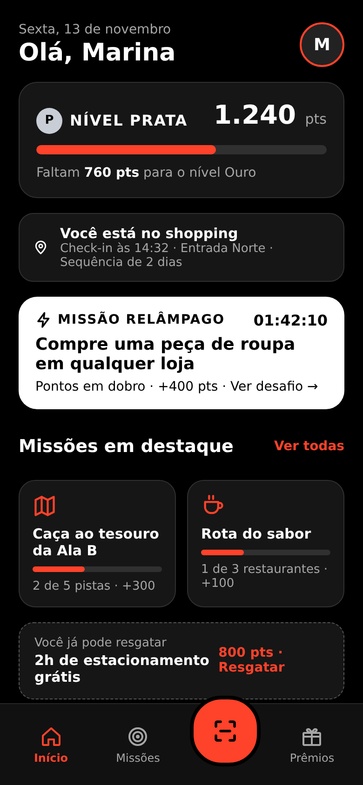
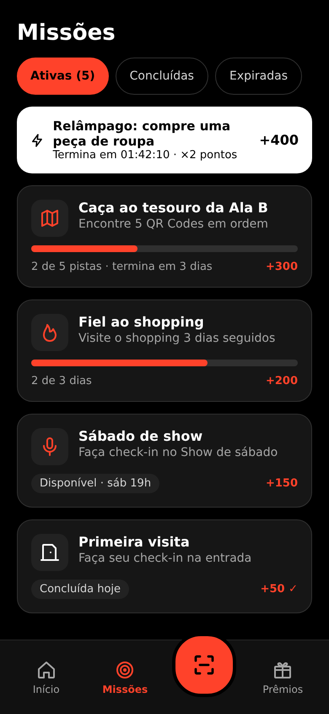
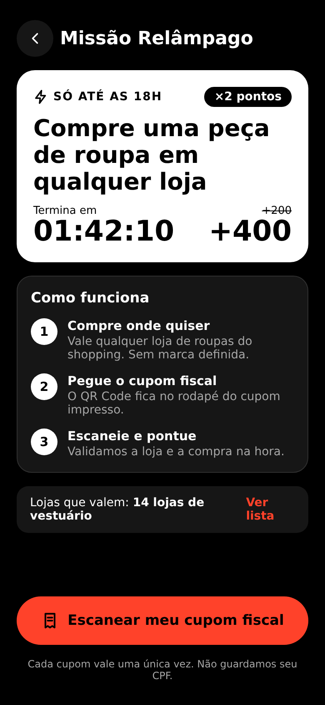
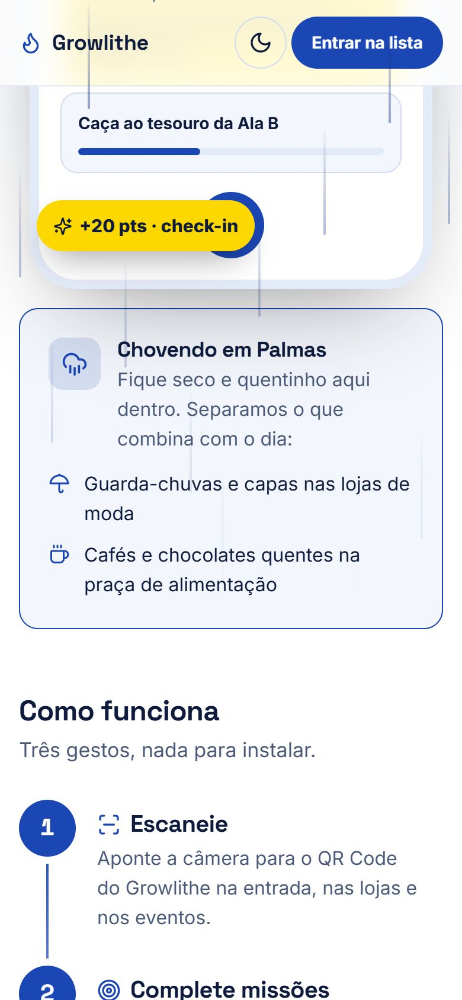
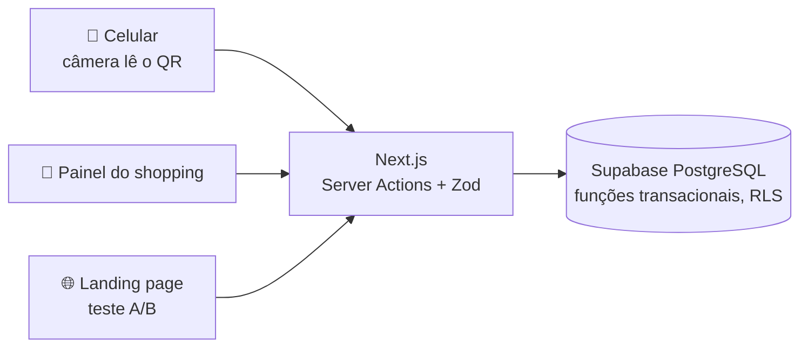

# 🔥 Growlithe

**Missões que fazem você voltar ao shopping.**

Web app gamificado de fidelização para shopping centers: o visitante aponta a câmera do celular para QR Codes espalhados pelo shopping, cumpre missões, ganha pontos e sobe de nível, **sem instalar nada**. O shopping ganha um painel para criar missões, imprimir os QR Codes e acompanhar a circulação em tempo real.

> Projeto criado em 2 dias no **HackaRun 2026** (Desafio 05 · Engajamento e fidelização, Shopping Capim Dourado, Palmas-TO) pelo **Time 26**. O site e o banco usados na competição foram desativados; o código está completo e roda localmente ([como rodar](#-como-rodar)).



---

## 💡 O problema

- A visita ao shopping é **transacional**: a pessoa compra o que precisava e vai embora, sem motivo para voltar.
- O shopping **não conhece o visitante**: não sabe quem veio, com que frequência, nem quais ações funcionam.
- Programas de fidelidade dão trabalho (cadastrar nota, cartão de pontos), e **app para instalar tem baixo alcance**.

## ✅ A solução

| Para quem | O que o Growlithe faz |
|---|---|
| **Visitante** | Escaneia o QR com a câmera nativa, ganha pontos na hora, sobe de nível (Bronze → Prata → Ouro → Diamante) e cumpre missões: caça ao tesouro, check-in em evento e **Missão Relâmpago** com pontos multiplicados. Premia quem **passeia**, não só quem gasta. |
| **Shopping (admin)** | Cadastra pontos físicos e imprime QR Codes assinados, cria e encerra missões, e vê um **dashboard** com check-ins, visitantes, scans por ponto e conversão da landing page. |
| **Lojista** | Valida o cupom de resgate de 6 dígitos e vê só o primeiro nome e o nível do visitante (LGPD). |

Também tem uma **landing page** com teste A/B de manchete e lista de espera, e um **easter egg** de sexta-feira 13 (mascote dormindo de madrugada e chuva na tela quando chove em Palmas).

## 📸 Telas

| Landing (celular, escuro) | Landing (celular, claro) | Entrar pelo QR | Painel do shopping |
|---|---|---|---|
|  |  |  |  |

| Protótipo: Home | Protótipo: Missões | Protótipo: Missão Relâmpago | Easter egg: chuva |
|---|---|---|---|
|  |  |  |  |

Mais telas e os dois temas em [`docs/wireframes/`](docs/wireframes/) e [`docs/screenshots/`](docs/screenshots/).

## 🛠️ Tecnologias

| Camada | Tecnologia | Por quê |
|---|---|---|
| Linguagem | **TypeScript** (strict) + **SQL** | Uma linguagem no front e no back; regras críticas rodam no banco |
| Interface | **React 19** + **Next.js 15** (App Router, Server Actions) | Telas e servidor no mesmo projeto, um deploy só |
| Banco e login | **Supabase** (PostgreSQL, Auth com link mágico, RLS) | Banco, login sem senha e regras de acesso prontos |
| Validação | **Zod** | Valida todo dado de entrada; o tipo TypeScript nasce do schema |
| Qualidade | **Vitest**, **ESLint** (typescript-eslint), **GitHub Actions** | 193 testes, testes de banco e CI em todo pull request |
| Hospedagem | **Vercel** | Usada durante a competição (hoje desativada) |

Por que cada escolha, em detalhe: [`docs/04-linguagem.md`](docs/04-linguagem.md) e [`docs/06-stack.md`](docs/06-stack.md).

## ⭐ Destaques técnicos

- **QR Code à prova de fraude:** cada QR é assinado (HMAC-SHA256) e conferido **dentro do banco**; o segredo nunca chega ao navegador.
- **Pontos só mudam no banco**, numa transação, com histórico (`point_ledger`). Um mesmo ponto pontua **1 vez por dia**, garantido por `UNIQUE`, mesmo com cliques simultâneos.
- **Segurança por linha (RLS):** o lojista só lê o que é da loja dele, mesmo tentando burlar o app.
- **Estados impossíveis não compilam:** uniões discriminadas e zero `any` ou `as` (o lint barra).
- **Spec-driven development:** toda funcionalidade passou por grill → spec → tickets → teste primeiro → code review ([`docs/specs/`](docs/specs/)).

## 🏗️ Arquitetura



Monólito modular: um projeto Next.js com o app do visitante (`/app`), o painel (`/painel`) e a landing (`/`). Detalhes em [`docs/05-arquitetura.md`](docs/05-arquitetura.md) e no modelo de dados em [`docs/03-modelo-de-dados.md`](docs/03-modelo-de-dados.md).

## 🚀 Como rodar

Precisa de **Node 22+**, **pnpm 9** e um projeto gratuito no **Supabase**.

```bash
git clone https://github.com/RohtiVM/26-growlithe.git
cd 26-growlithe
pnpm install
cp .env.example .env.local   # preencha a URL e a chave publishable do Supabase
pnpm dev                      # http://localhost:3000
```

Antes, aplique as migrations de `supabase/migrations/` e o `supabase/seed.sql` no seu projeto Supabase. O passo a passo completo, incluindo como virar admin do painel, está em [`docs/EXECUCAO.md`](docs/EXECUCAO.md).

```bash
pnpm test        # testes
pnpm typecheck   # tipos (inclui testes de tipo)
pnpm test:db     # migrations e RLS num Postgres temporário
```

## 📂 Estrutura

```
src/
├── app/        rotas: landing (/), app do visitante (/app), painel (/painel), QR (/s/[token])
├── domain/     schemas Zod e regras de negócio (fonte única dos tipos)
├── visitor/    scan, login e telas do visitante
├── painel/     checkpoints, missões, validação de resgate e dashboard
├── landing/    teste A/B e lista de espera
├── server/     Supabase, ambiente e assinatura de QR
└── ui/         temas escuro e claro
supabase/       migrations, seed e testes de banco
docs/           specs, arquitetura, modelo de dados, telas e documentos da competição
```

## 🧭 Aprendizados e próximos passos

O projeto não venceu o tema. O time vencedor teve uma proposta parecida, com dois diferenciais que ficam como ideias de evolução:

- **Mapa de calor na planta do shopping**, mostrando onde há mais e menos gente.
- **Roleta de prêmios**, em vez de prêmios fixos.

Também estão no caminho: validar compras pelo **QR do cupom fiscal (NFC-e)**, já especificado e modelado ([spec 001](docs/specs/001-missao-relampago.md)), e uma vitrine para o visitante trocar pontos por prêmios no app.

## 📚 Documentação da competição

- [`docs/ENTREGA-HACKATHON.md`](docs/ENTREGA-HACKATHON.md): README original entregue à banca (problema, objetivos, arquitetura, prática sorteada).
- [`docs/RESUMO-AVALIADORES.md`](docs/RESUMO-AVALIADORES.md): resumo de uma página.
- [`docs/12-pitch-90s.md`](docs/12-pitch-90s.md): o pitch em vídeo de 90 segundos, explicado.
- [`docs/specs/`](docs/specs/): as especificações de cada funcionalidade.

## 👥 Time 26

Bruno Reis Mendes · Jhuan Pablo Noleto Cardoso · Ricardo Silva Freitas · Vithor Borges Ferreira Moura
