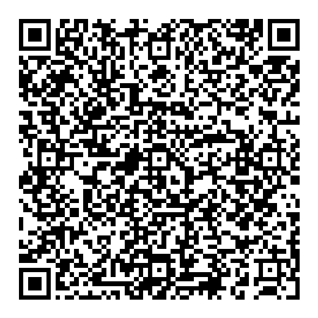
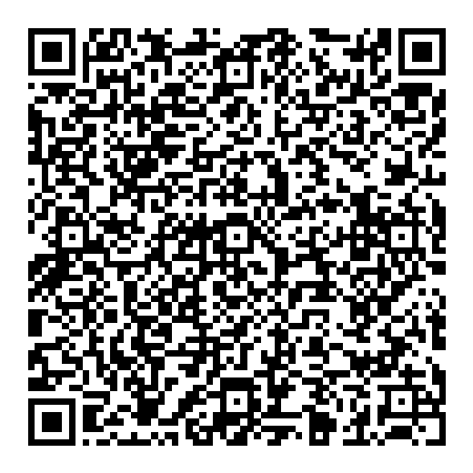
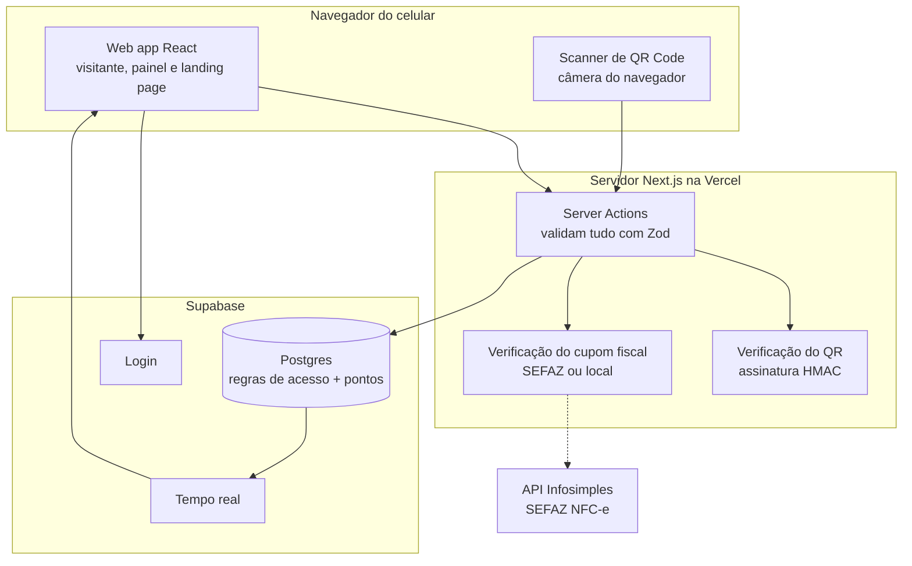
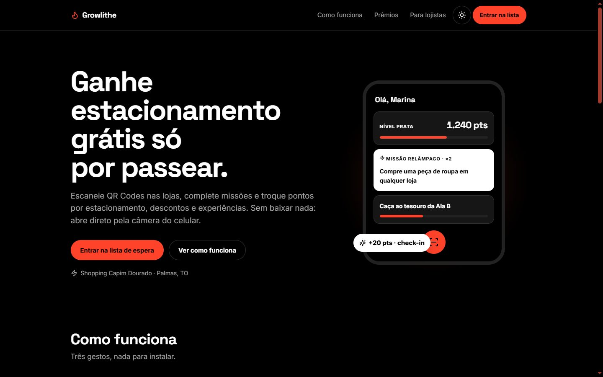
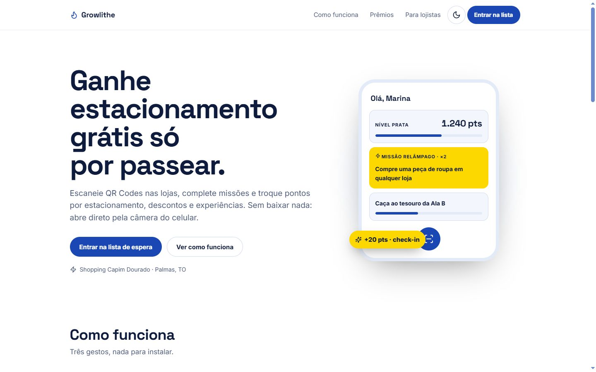
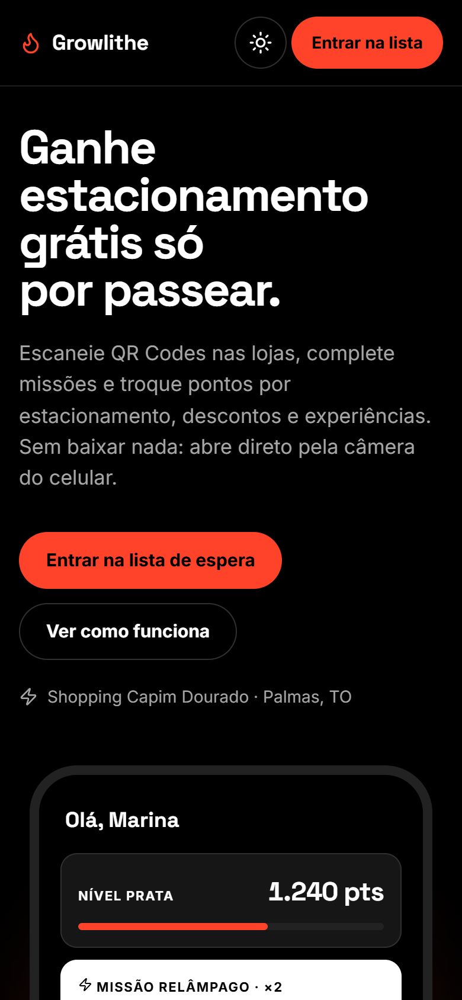
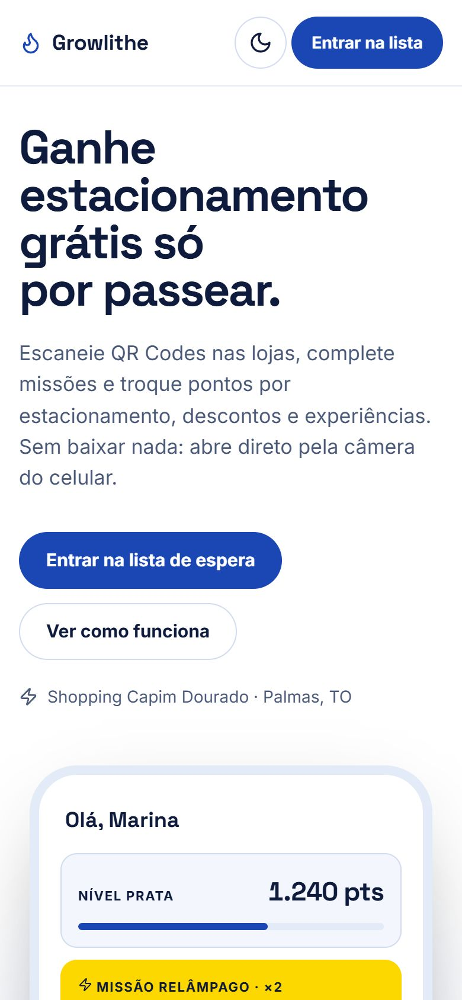
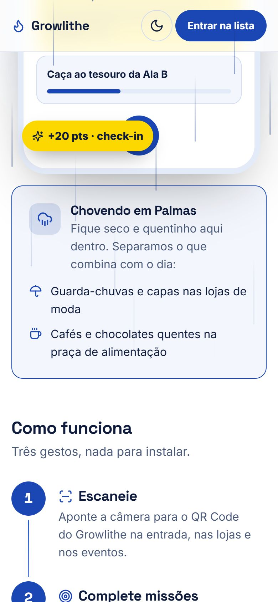
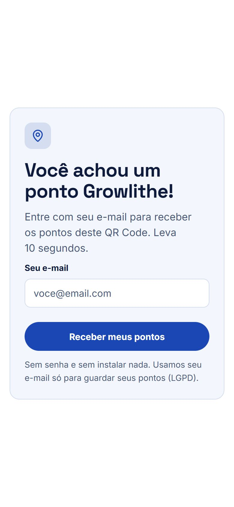
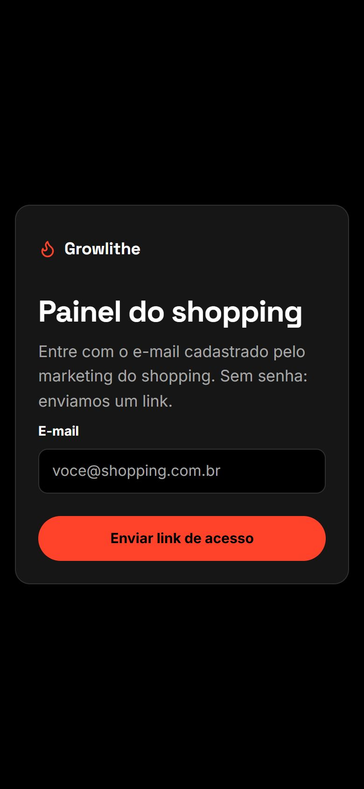

# 🔥 Growlithe — Time 26

> **Integrantes:** Bruno Reis Mendes · Jhuan Pablo Noleto Cardoso · Ricardo Silva Freitas · Vithor Borges Ferreira Moura
>
> **Missões que fazem você voltar ao shopping.**
> Hackathon · Desafio **05. Engajamento e fidelização dos visitantes** · Shopping Capim Dourado, Palmas (TO)
>
> 🌐 **MVP no ar: https://growlithe-flax.vercel.app** · Entrega 1 (planejamento, 13/11) · MVP final (14/11)

### 📦 Entrega final (14/11)

| Item pedido | Onde está |
|---|---|
| MVP funcional | **https://growlithe-flax.vercel.app** |
| Repositório | este repositório (público) |
| Documentação técnica | este README, seções 3–4, e [`docs/`](docs/) (arquitetura, modelo de dados, stack, specs) |
| Instruções de execução | [`docs/EXECUCAO.md`](docs/EXECUCAO.md) |
| Resumo de uma página para os avaliadores | [`docs/Growlithe-resumo-avaliadores.pdf`](docs/Growlithe-resumo-avaliadores.pdf) · [versão em texto](docs/RESUMO-AVALIADORES.md) |
| Vídeo de 90 segundos | entregue à parte pela equipe |

### 📱 Guia rápido para os avaliadores (5 minutos, no seu celular)

**Missão:** complete a *Caça ao tesouro do avaliador*: escaneie o QR 1 e depois o QR 2. Pontos em dobro!

| QR 1 · Entrada (check-in) | QR 2 · Praça de alimentação |
|---|---|
|  |  |

1. **Escaneie o QR 1** com a câmera do celular e toque em **"Entrar como avaliador"** — sem e-mail, sem senha, sem instalar nada. Você ganha os pontos do check-in e vê *"Caça ao tesouro: 1 de 2"*.
2. **Escaneie o QR 2.** A missão fica concluída e os pontos vêm **em dobro** (Missão Relâmpago). Toque em *Ver minhas missões* para ver nível, saldo e presença no shopping.
3. **Veja o lado do shopping:** abra **https://growlithe-flax.vercel.app/painel** no mesmo celular. Como avaliador você entra como **admin**: veja o **Dashboard** (o seu scan já aparece), crie uma missão em **Missões** e imprima QR Codes em **Checkpoints**.
4. **Bônus:** `/?easter=noite` e `/?easter=chuva` mostram o easter egg de sexta-feira 13; o botão ☀️/🌙 troca o tema.

**No notebook, sem celular?** Abra **https://growlithe-flax.vercel.app**, clique em **"Avaliador? Teste agora, sem cadastro"** e siga o *Guia do avaliador* que aparece no app: os botões *QR 1* e *QR 2* fazem o scan com um clique. Para alternar entre as duas áreas, use o ícone de **painel** no topo do app e o botão **Visitante** no topo do painel.

O acesso de avaliador vale até **15/11 às 23h59** e depois expira sozinho. Cada conta pontua uma vez por dia em cada ponto (antifraude).

---

## 1. Nome do projeto e descrição (pitch)

**Growlithe** é um **web app gamificado, feito em React**, que transforma a visita ao shopping em uma jornada de missões, pontos e prêmios. Ele abre direto no navegador do celular, **sem instalar nada**.

### Contexto
O desafio é do **Shopping Capim Dourado** (Palmas, TO). Shopping centers deixaram de ser só lugares de compra: competem com o comércio online e com outras opções de lazer pela atenção e pelo tempo das pessoas. Para continuar relevante, o shopping precisa criar um **relacionamento contínuo com o visitante**, um motivo para ele voltar, circular por mais lojas e ficar mais tempo. Ao mesmo tempo, quase todo visitante já anda com um celular com câmera e internet, e o QR Code virou um hábito no Brasil (Pix, cardápios, cupons fiscais).

### Problemática
- A visita é **transacional**: a pessoa entra, compra o que precisava e vai embora, sem motivo concreto para voltar.
- O shopping **não conhece o visitante**: não sabe quem veio, com que frequência, nem quais ações funcionam.
- Os programas de fidelidade tradicionais (cadastrar nota fiscal, cartão de pontos) **dão trabalho** e só recompensam quem já gasta muito.
- Soluções em **aplicativo para instalar têm baixo alcance**: poucas pessoas baixam um app só para ganhar um benefício no shopping.
- Lojistas de alas menos movimentadas **não recebem fluxo** de pessoas.

### Justificativa
Gamificação (missões, níveis, sequências e recompensas) é uma forma comprovada de criar hábito e retorno, como mostram apps como Duolingo e Strava. Entregar isso como **web app aberto por QR Code** elimina a barreira da instalação e alcança qualquer visitante com celular. Validar compras pelo **QR Code do cupom fiscal**, que toda loja já emite, permite recompensar a compra **sem integração com os sistemas dos lojistas**, o que torna a solução viável e barata de implantar desde o primeiro dia. Para o shopping, cada scan vira dado de circulação e de retorno, que hoje ele não tem.

### Objetivo geral
Desenvolver um web app gamificado que **aumente o engajamento e a fidelização dos visitantes** do shopping, criando um relacionamento contínuo por meio de missões, pontos, níveis e recompensas reais.

### Objetivos específicos
1. Permitir que o visitante acesse a solução **pela câmera do celular, sem instalar aplicativo**.
2. Implementar **missões por QR Code**: check-in, caça ao tesouro, sequência de visitas e eventos.
3. Implementar a **Missão Relâmpago**, com validação da compra pelo **QR Code do cupom fiscal (NFC-e)**.
4. Criar o sistema de **pontos, níveis e resgate de prêmios**, com validação pelo lojista.
5. Oferecer ao shopping um **painel** para criar missões e acompanhar circulação, retorno e resultados.
6. Validar o interesse do público com uma **landing page** com lista de espera, teste A/B e métricas de conversão.
7. Garantir **segurança e LGPD**: QR Codes assinados, cupom de uso único e nenhum armazenamento de CPF.

### Proposta de solução
O visitante **aponta a câmera do celular para um QR Code** espalhado pelo shopping e já está jogando:

- **Missões:** check-in na entrada, caça ao tesouro com QR Codes em ordem, sequência de visitas e check-in em eventos.
- **⚡ Missão Relâmpago:** desafio surpresa e genérico, como *"compre uma peça de roupa em qualquer loja até as 18h e ganhe pontos em dobro"*. A compra é validada pelo **QR Code do cupom fiscal (NFC-e)**, que toda loja já imprime, **sem integração com os lojistas**.
- **Pontos e níveis:** Bronze → Prata → Ouro → Diamante.
- **Prêmios reais:** estacionamento grátis, descontos nas lojas e experiências, resgatados com um código de 6 dígitos que o lojista valida.
- **Painel do shopping:** criar missões, lançar Missões Relâmpago por notificação e acompanhar circulação e resultados.

**Ganha o visitante** (diversão e benefícios), **o lojista** (gente na porta e venda) e **o shopping** (relacionamento contínuo e dados de circulação).

➜ Visão completa, personas e métricas: [`docs/02-visao-do-produto.md`](docs/02-visao-do-produto.md)

---

## 2. Grupo e integrantes

**Time 26 — Growlithe**

| Integrante | Papel |
|---|---|
| Bruno Reis Mendes | _a definir_ |
| Jhuan Pablo Noleto Cardoso | _a definir_ |
| Ricardo Silva Freitas | _a definir_ |
| Vithor Borges Ferreira Moura | _a definir_ |

---

## 3. Linguagem, plataforma e tecnologias

| Camada | Escolha | Por quê |
|---|---|---|
| **Linguagem** | **TypeScript** (modo `strict`) | Uma linguagem só no front e no back; erros aparecem na hora de compilar, não na demo |
| **Interface** | **React** com o framework **Next.js** | Biblioteca de interface mais usada no mercado; o time já conhece JavaScript |
| **Plataforma** | **Web app** no navegador do celular | Sem instalação (maior alcance, orientação do mentor); um código só para Android e iPhone |
| Estilo | Tailwind CSS + shadcn/ui | Componentes acessíveis e rápidos de montar |
| Validação e tipos | Zod | Um schema gera o tipo TypeScript e valida os dados reais (formulários, QR Codes, banco) |
| Banco e login | Supabase (Postgres, Auth, Realtime) | Banco gerenciado, login por link mágico e atualização em tempo real |
| Cupom fiscal | API Infosimples (SEFAZ / NFC-e) | Confere data, valor e itens da compra; se a consulta cair, valida localmente pela chave do QR |
| Hospedagem | Vercel | Deploy a cada push e link de preview para cada mudança |
| Processo | GitHub + GitHub Actions + skills do Matt Pocock | Spec-driven development (grill me → spec → implement) e CI em todo PR |

**Identidade visual:** dois temas. **Escuro** em vermelho `#FF422A`, preto e branco; **claro** com as cores da bandeira do Tocantins (azul `#1B47B4`, branco e amarelo `#FDD700`). O app segue o modo do celular. Todos os pares de texto passam no contraste AA ([`src/ui/theme.ts`](src/ui/theme.ts)).

➜ Detalhes: [`docs/04-linguagem.md`](docs/04-linguagem.md) · [`docs/06-stack.md`](docs/06-stack.md) · [`docs/09-integracao-sefaz.md`](docs/09-integracao-sefaz.md) · [`docs/10-processo-de-desenvolvimento.md`](docs/10-processo-de-desenvolvimento.md)

---

## 4. Arquitetura proposta

**Monólito modular em React/Next.js**: um único projeto e um único deploy reúnem o web app do visitante, o painel do shopping e a landing page. Todos compartilham o mesmo **modelo de domínio tipado** ([`src/domain/schemas.ts`](src/domain/schemas.ts)), então o front e o back nunca discordam sobre o formato dos dados.



**Princípios:**
- **Toda entrada é validada na borda** (QR Code, formulário, resposta da SEFAZ, linha do banco) com Zod antes de chegar à regra de negócio.
- **Pontos só mudam no banco**, numa função transacional. Um mesmo QR ou cupom nunca pontua duas vezes, nem com duas requisições ao mesmo tempo.
- **QR Codes assinados** (não dá para forjar) e cupom fiscal de **uso único** (antifraude).
- **Estados modelados para não existirem combinações inválidas** (por exemplo, um cupom "resgatado" sempre tem data de resgate). Isso é garantido pelo compilador e coberto por testes de tipo.
- **LGPD:** do cupom fiscal guardamos só loja, valor e horário; nunca o CPF.

➜ Diagramas de sequência, segurança e decisões: [`docs/05-arquitetura.md`](docs/05-arquitetura.md) · Modelo de dados: [`docs/03-modelo-de-dados.md`](docs/03-modelo-de-dados.md)

---

## 5. Tecnologia ou prática da roleta: **Landing Page**

Eixo sorteado: **Testes, métricas e lançamento → Landing page**.

**Onde está:** é a página inicial do site, **https://growlithe-flax.vercel.app/** (código em `src/app/page.tsx`). O formulário grava os leads no banco com a variante do teste A/B e a origem (UTM), e o dashboard do painel mostra a conversão de cada variante.

A landing page do Growlithe é o **primeiro experimento do produto**: ela responde com dados se as pessoas querem a solução.

- **Três públicos, três chamadas:** visitante ("Entrar na lista de espera"), lojista ("Quero minha loja no Growlithe") e shopping ("Agendar demonstração"), todos no mesmo formulário com validação Zod e aceite da LGPD.
- **Mesmo projeto React** do app, na rota `/`, com o mesmo visual e os mesmos componentes.
- **Teste A/B de manchete:** A: *"Seu passeio no shopping agora vale prêmios."* × B: *"Ganhe estacionamento grátis só por passear."*
- **Métricas:** taxa de conversão (meta > 15%), conversão por público, origem dos cadastros (UTM), cliques e rolagem, tempo de carregamento.
- **QR Code de novo:** cartazes no shopping e o slide do pitch levam à landing page com UTM, para medir qual ponto físico traz mais cadastros. **Na apresentação, a banca escaneia o QR do slide e se cadastra ao vivo.**

➜ Detalhes: [`docs/07-pratica-sorteada-landing-page.md`](docs/07-pratica-sorteada-landing-page.md)

---

## 6. Telas

### MVP publicado (capturas reais de https://growlithe-flax.vercel.app)

| Landing · desktop, tema escuro | Landing · desktop, tema claro (Tocantins) |
|---|---|
|  |  |

| Landing · celular, escuro | Landing · celular, claro | Easter egg: madrugada | Easter egg: chuva |
|---|---|---|---|
|  |  |  |  |

| Escaneou um QR sem login | Login do painel |
|---|---|
|  |  |

As telas internas (Home do visitante, resultado do scan e painel logado) exigem login; os wireframes abaixo mostram o desenho aprovado delas.

<details>
<summary><strong>Wireframes da Entrega 1 (planejamento, 13/11)</strong></summary>

Wireframes de alta fidelidade salvos em [`docs/wireframes/`](docs/wireframes/), nos dois temas. Há também o **protótipo navegável** em [canvas de design](https://claude.ai/artifact/8nLcM6mxjsQEm2uV5QB1ae). A estrutura é inicial e vai evoluir durante o hackathon.

**Fluxo principal:** Home → Missão Relâmpago → Scanner → Resultado → Prêmios → Cupom de resgate.

### Tema escuro

| Home | Missões | Scanner | Resultado do scan |
|---|---|---|---|
|  |  |  |  |

| Missão Relâmpago | Prêmios | Cupom de resgate |
|---|---|---|
|  |  |  |

### Tema claro (cores do Tocantins)

| Home | Missões | Scanner | Resultado do scan |
|---|---|---|---|
|  |  |  |  |

| Missão Relâmpago | Prêmios | Cupom de resgate |
|---|---|---|
|  |  |  |

### Landing page

[Tema escuro](docs/wireframes/tema-escuro/09-landing-page.png) · [Tema claro](docs/wireframes/tema-claro/09-landing-page.png)

➜ Mapa de telas, fluxos e wireframes em texto (incluindo o painel admin): [`docs/01-telas-e-fluxos.md`](docs/01-telas-e-fluxos.md)

---

</details>

## Estado do MVP (14/11)

**No ar:** **https://growlithe-flax.vercel.app** — Vercel, funções em São Paulo (`gru1`), banco Supabase em São Paulo. Cada merge na `main` publica sozinho e cada PR ganha um link de prévia. O endereço `growlithe-rohti-vm.vercel.app` é protegido pela Vercel (pede login): **não use no pitch**.

**Pitch em vídeo (90s):** [pasta no Google Drive](https://drive.google.com/drive/folders/1HnbZgDDafRDLrcILaWlRbN8c1phL2b7P) · o que o vídeo diz e onde cada afirmação está no MVP: [`docs/12-pitch-90s.md`](docs/12-pitch-90s.md)

| Área | Rotas | Spec |
|---|---|---|
| Landing com teste A/B e lista de espera (prática sorteada) | `/` | [002](docs/specs/002-landing-page.md) |
| App do visitante: escanear, ganhar pontos, nível, missões | `/s/<token>`, `/app`, `/app/missoes`, `/app/entrar` | [004](docs/specs/004-checkin-missao-qr.md) |
| Painel do shopping (admin e lojista) | `/painel`, `/painel/checkpoints`, `/painel/missoes`, `/painel/validar`, `/painel/dashboard` | [003](docs/specs/003-painel-admin.md) |
| Easter egg de sexta-feira 13 (madrugada e chuva) | `/?easter=noite`, `/?easter=chuva` | [006](docs/specs/006-easter-egg-sexta-13.md) |
| Botão de tema claro / escuro | todas as páginas com cabeçalho | [007](docs/specs/007-escolha-de-tema.md) |
| Modo avaliador: entrar sem e-mail e ver o painel (até 15/11) | botão no scan, em `/app/entrar` e em `/painel/login` | [008](docs/specs/008-modo-avaliador.md) |
| Missão Relâmpago por cupom fiscal (NFC-e) | — planejada | [001](docs/specs/001-missao-relampago.md) |

**Segurança:** o QR do checkpoint é assinado e conferido **dentro do banco** (o segredo nunca sai de lá); pontos só mudam por funções transacionais; RLS em todas as tabelas; do visitante, o painel só vê primeiro nome e nível (LGPD).

**Qualidade:** TypeScript strict sem `any`/`as`, 193 testes Vitest, testes de banco (RLS e regras) num Postgres temporário, CI em todo PR (tipos, lint, testes, build e banco).

### Como rodar

Passo a passo completo, inclusive criando um banco Supabase próprio: [`docs/EXECUCAO.md`](docs/EXECUCAO.md).

```bash
pnpm install          # no Windows/PowerShell: pnpm.cmd
pnpm dev              # http://localhost:3000
pnpm typecheck && pnpm lint && pnpm test && pnpm build
pnpm test:db          # migrations + RLS num Postgres temporário (precisa de Postgres 15+)
```

Crie o `.env.local` com `NEXT_PUBLIC_SUPABASE_URL=https://wmqymygwjppykjsejzah.supabase.co` e `NEXT_PUBLIC_SUPABASE_ANON_KEY` (chave *publishable* em *Project Settings → API keys*). Não há segredo de QR no `.env`: ele vive no banco.

### Roteiro da demo

1. No painel (`/painel`, admin), **Checkpoints → Imprimir QR** da "Entrada principal" (check-in, 20 pts) — imprima a partir de `growlithe-flax.vercel.app` para o QR apontar para o site publicado. Crie uma **Missão Relâmpago** em **Missões**.
2. No celular: escanear o QR → entrar com um e-mail → informar o nome → ver os pontos e a missão; abrir `/app`.
3. No painel: **Dashboard** com check-ins, scans por checkpoint e conversão do A/B.
4. Easter egg: `/?easter=noite` e `/?easter=chuva`.

### Decisões para revisar

Tomadas na madrugada de 14/11 e marcadas com ⚠️: spec 004 D9–D15 (pontos base 10/20, caça ao tesouro fora de ordem, missão completa uma vez, multiplicador relâmpago, nome no primeiro login, endereços, celebração de nível) e spec 006 D3–D7 (mascote original, Open-Meteo, limiar de chuva forte, card no lugar do mapa, `?easter=`).

### Pendências conhecidas

- Lista automática de e-mails de admin (hoje: `select private.grant_staff('<e-mail>', 'admin', null);` no SQL Editor).
- Missão Relâmpago por cupom fiscal (spec 001) e resgate de recompensas pelo visitante (spec 005).
- Dados de teste no banco (leads do QA e visitas de teste). Para zerar o dashboard antes do pitch:
  `delete from public.landing_leads where email = 'qa-growlithe@example.com'; delete from public.landing_visits;`
- Branch `backup/mvp-local-13-11`: cópia de 3 commits de 13/11 feitos neste computador e nunca integrados (MVP alternativo com PWA e push). Preservada para consulta; a `main` seguiu outra arquitetura.

## Estrutura do repositório

```
growlithe/
├── README.md · CONTEXT.md (glossário) · CLAUDE.md (fluxo spec-driven)
├── docs/
│   ├── 01–10                     # planejamento da Entrega 1 (telas, visão, dados, arquitetura, stack…)
│   ├── 11-plano-entrega-final.md # prazos de 14/11, critérios e ordem de entrega
│   ├── 12-pitch-90s.md           # o que o vídeo de 90s diz e onde está no MVP
│   ├── specs/                    # 000-template · 001 a 004 · 006 a 008
│   └── wireframes/               # telas em PNG, tema escuro e claro
├── src/
│   ├── app/                      # rotas Next.js: landing, /app, /s/<token>, /painel, /auth
│   ├── domain/schemas.ts         # modelo de domínio (Zod): fonte única dos tipos
│   ├── visitor/                  # regras e telas do app do visitante (scan, nível, missões)
│   ├── painel/                   # regras do painel (acesso, checkpoints, missões, resgate, dashboard)
│   ├── landing/                  # teste A/B, lista de espera, contagem regressiva
│   ├── easter/                   # easter egg (horário e clima)
│   ├── server/                   # Supabase no servidor, visitante, equipe, QR
│   ├── ui/                       # temas e botão de tema
│   └── middleware.ts             # sessão do Supabase, variante A/B e contagem de visitas
├── supabase/
│   ├── migrations/               # 7 migrations, com as mesmas versões do projeto Supabase
│   ├── seed.sql                  # lojas, checkpoints e recompensas de demonstração
│   └── tests/                    # testes de banco num Postgres temporário
├── .github/
│   ├── workflows/ci.yml          # tipos, lint, testes, build e banco em todo PR
│   └── pull_request_template.md  # PR exige spec, ticket e critérios de aceite
└── package.json · tsconfig.json · eslint.config.mjs · vitest.config.ts · next.config.ts · .env.example
```
