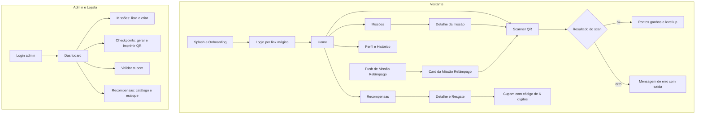
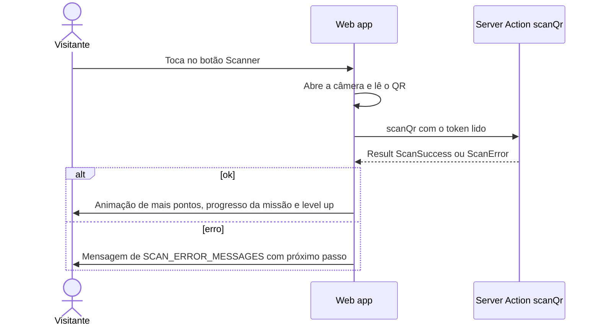

# 01 · Proposta e Estrutura Inicial das Telas

> 🎨 **Telas visuais (protótipo navegável):** [https://claude.ai/artifact/8nLcM6mxjsQEm2uV5QB1ae](https://claude.ai/artifact/8nLcM6mxjsQEm2uV5QB1ae)
> 9 telas: Home, Missões, Scanner, Resultado do scan, Missão Relâmpago, Prêmios, Cupom de resgate, Painel admin e Landing page. No modo Play, os botões navegam entre as telas.

## Identidade visual: dois temas

O visitante escolhe o tema no perfil. Por padrão, o app segue o modo claro ou escuro do celular.

| | **Tema escuro** (página "Tema escuro" no canvas) | **Tema claro** (página "Tema claro" no canvas) |
|---|---|---|
| Inspiração | Vermelho, preto e branco: energia de jogo, ligado ao nome "Growlithe" (fogo) | Bandeira do Tocantins: identidade local |
| Fundo | Preto `#000000` | Branco `#FFFFFF` |
| Primária (botões, progresso, links) | Vermelho `#FF422A`, com **texto preto** nos botões | Azul `#1B47B4`, com texto branco |
| Missão Relâmpago | Cartão branco, texto preto | Cartão amarelo `#FDD700`, texto azul-marinho `#0E1B3D` |
| Texto / secundário | `#FFFFFF` / `#A6A6A6` | `#0E1B3D` / `#4A5878` |

- **Fonte única dos tokens:** [`src/ui/theme.ts`](../src/ui/theme.ts). São 11 tokens, e o `satisfies` obriga os dois temas a definir todos eles.
- **Contraste verificado:** os 16 pares de texto e fundo usados nas telas (8 por tema) passam no AA (4,5:1). O menor é o vermelho sobre cartão escuro, com 5,2:1.
- **Regra:** texto branco nunca vai sobre o vermelho (3,5:1, reprovado) e amarelo nunca é usado como texto sobre fundo claro.
- **Tipografia:** títulos em Space Grotesk, textos em Inter. Fonte base de 15 a 16 px e botões com no mínimo 44 px, pensando no público geral.
- **Erros não dependem só da cor:** no tema escuro a primária é vermelha, então mensagens de erro sempre levam ícone e texto explicativo.

**Web app** em React, mobile-first (390 px), que abre no navegador sem instalação. Há duas áreas no mesmo projeto React/Next.js: o do **visitante** e o **painel admin/lojista**.

## Mapa de telas



A navegação do visitante usa uma **tab bar fixa** com 4 itens: Início · Missões · **[Scanner]** (botão central em destaque) · Recompensas. O Perfil fica no avatar, no topo da tela.

---

## Fluxo principal — "Escanear e ganhar"



Se o visitante escanear o QR com a câmera nativa do celular, em vez de usar o scanner do app, o QR aponta para `https://growlithe.app/s/<token>`. Essa rota abre o web app no navegador e faz o mesmo scan. **Nenhum visitante fica sem caminho.**

---

## Wireframes em texto

### V2 · Home

```
┌─────────────────────────────────┐
│ Olá, Marina 👋          (avatar)│
│ ┌─────────────────────────────┐ │
│ │ 🥈 PRATA      1.240 pts      │ │
│ │ ███████████░░░░  760 p/ Ouro │ │
│ └─────────────────────────────┘ │
│ ┌─────────────────────────────┐ │
│ │ 📍 Você está no shopping     │ │
│ │ Check-in 14:32 · Entr. Norte │ │  ← Presence: at_mall
│ └─────────────────────────────┘ │  (se "away": botão [Fazer check-in])
│ 🔥 Sequência: 2 dias            │
│                                 │
│ Missões em destaque      Ver +  │
│ ┌──────────┐ ┌──────────┐       │
│ │🗺 Caça ao │ │☕ Café da │       │
│ │ tesouro  │ │  manhã   │       │
│ │ 2/5 · 150│ │ +50 pts  │       │
│ └──────────┘ └──────────┘       │
│                                 │
│ Já pode resgatar 🎁             │
│ [Estac. 2h grátis — 800 pts]    │
├─────────────────────────────────┤
│ 🏠 Início  🎯 Missões (📷) 🎁 Rec.│
└─────────────────────────────────┘
```

### V3 · Missões

```
┌─────────────────────────────────┐
│ Missões                         │
│ [Ativas] [Concluídas] [Expiradas]│ ← filtro por MissionProgress.status
│                                 │
│ ┌─────────────────────────────┐ │
│ │ 🗺 Caça ao tesouro da Ala B  │ │
│ │ Encontre 5 QR Codes em ordem │ │
│ │ ████░░░░░  2/5     +150 pts  │ │  ← in_progress
│ │ termina em 3 dias            │ │
│ └─────────────────────────────┘ │
│ ┌─────────────────────────────┐ │
│ │ 🔥 Volte 3 dias seguidos     │ │
│ │ ██████████░  2/3   +200 pts  │ │
│ └─────────────────────────────┘ │
│ ┌─────────────────────────────┐ │
│ │ 🎤 Show de sábado (evento)   │ │
│ │ Disponível         +100 pts  │ │  ← available
│ └─────────────────────────────┘ │
└─────────────────────────────────┘
```

O card é renderizado por um `switch (progress.status)` exaustivo (`progressLabel`). Se alguém criar um status novo, o build quebra até que a UI trate o caso.

### V5 · Scanner

```
┌─────────────────────────────────┐
│ ✕                    🔦 Lanterna │
│                                 │
│      ┌───────────────────┐      │
│      │                   │      │
│      │   [ câmera ao vivo ]     │
│      │                   │      │
│      └───────────────────┘      │
│                                 │
│  Aponte para o QR Code da loja  │
│                                 │
│  Não consegue escanear?         │
│  [Digitar código do ponto]      │  ← fallback acessível
└─────────────────────────────────┘
```

### V6a · Resultado (sucesso)

```
┌─────────────────────────────────┐
│             ✨ +50 ✨            │
│         pontos ganhos!          │
│                                 │
│  🗺 Caça ao tesouro  3/5         │
│  ██████░░░░                     │
│                                 │
│  ┌───────────────────────────┐  │
│  │ 🥇 Você subiu para OURO!   │  │  ← só se tierUp !== null
│  └───────────────────────────┘  │
│                                 │
│  [ Ver próxima pista ]          │
│  [ Voltar ao início ]           │
└─────────────────────────────────┘
```

### V6b · Resultado (erro)

```
┌─────────────────────────────────┐
│               ⏰                │
│  Você já escaneou este ponto    │
│  hoje. Volte amanhã!            │  ← SCAN_ERROR_MESSAGES[error]
│                                 │
│  [ Ver outras missões ]         │
└─────────────────────────────────┘
```

### V7/V8 · Recompensas e resgate

```
┌─────────────────────────────────┐
│ Recompensas      Saldo: 1.240   │
│ [Todas] [Estacion.] [Descontos] │
│ ┌─────────────────────────────┐ │
│ │ 🅿️ 2h de estacionamento grátis│ │
│ │ 800 pts           [Resgatar] │ │
│ └─────────────────────────────┘ │
│ ┌─────────────────────────────┐ │
│ │ 🍔 15% de desconto · Burger X│ │
│ │ 500 pts           [Resgatar] │ │
│ └─────────────────────────────┘ │
│ ┌─────────────────────────────┐ │
│ │ 🔒 Brinde exclusivo          │ │
│ │ Nível Ouro · 1.500 pts       │ │  ← minTier bloqueia
│ └─────────────────────────────┘ │
└─────────────────────────────────┘
```

### V9 · Cupom

```
┌─────────────────────────────────┐
│ 15% de desconto · Burger X      │
│                                 │
│        ┌─────────────┐          │
│        │  4 8 2 9 1 7 │          │  ← Redemption.code (status: reserved)
│        └─────────────┘          │
│  Mostre este código no caixa    │
│  Válido até 13/11 às 22:00      │
│                                 │
│  (atualiza sozinho para         │
│   ✅ "Usado" via Realtime)       │
└─────────────────────────────────┘
```

### V11 · Missão Relâmpago (push + card)

```
  ┌───────────────────────────────┐
  │ ⚡ Growlithe · agora           │   ← notificação push
  │ MISSÃO RELÂMPAGO!             │
  │ Compre uma peça de roupa até  │
  │ as 18h e ganhe pontos em dobro│
  └───────────────────────────────┘

┌─────────────────────────────────┐
│ ⚡ MISSÃO RELÂMPAGO   ⏱ 01:42:10 │   ← contagem regressiva até endsAt
│ Compre uma peça de roupa        │
│ em qualquer loja do shopping    │   ← requirementLabel(purchase_category)
│                                 │
│ 🏷 +200 pts  ×2 = 400 pts        │   ← launch.pointsMultiplier
│                                 │
│ Como funciona:                  │
│ 1. Compre em qualquer loja de   │
│    roupas do shopping           │
│ 2. Escaneie o QR Code do rodapé │
│    do seu cupom fiscal          │
│                                 │
│ [ 📷 Escanear meu cupom ]       │
│ Lojas que valem: Ver lista →    │
└─────────────────────────────────┘
```

### V12 · Resultado da validação do cupom

```
┌─────────────────────────────────┐      ┌─────────────────────────────────┐
│          ✅ Compra validada!     │      │               🧾                │
│                                 │      │  Esse cupom não é de uma loja   │
│   Loja: Moda Center (vestuário) │      │  de roupas. Confira o desafio!  │
│   ⚡ +400 pts (em dobro)         │      │                                 │
│                                 │      │  [ Ver lojas que valem ]        │
│   [ Ver minhas recompensas ]    │      │  [ Tentar outro cupom ]         │
└─────────────────────────────────┘      └─────────────────────────────────┘
          sucesso                                 erro: wrong_category
```

### A3 · Admin — Criar missão

```
┌──────────────────────────────────────────────┐
│ Nova missão                                   │
│ Título*        [______________________]       │
│ Descrição      [______________________]       │
│ Tipo*          (•) QR Code  ( ) Sequência      │
│                ( ) Evento   ( ) Compra por categoria│
│ Lançamento     (•) Semanal  ( ) ⚡ Relâmpago (push)│
│ ── campos do tipo QR Code ──                  │  ← muda conforme requirement.kind
│ Checkpoints*   [☑ Burger X] [☑ Livraria] [+]  │
│ Em ordem?      [ ] caça ao tesouro            │
│ ──                                            │
│ Pontos*        [ 150 ]                        │
│ Início* [13/11]   Fim* [20/11]                │
│ Máx. por usuário [ 1 ]                        │
│                                [Criar missão] │
└──────────────────────────────────────────────┘
```

O formulário usa `react-hook-form` com `zodResolver(CreateMissionInput)`. Os campos dinâmicos vêm da união `MissionRequirement`: ao trocar o tipo, o TypeScript só oferece no autocomplete os campos daquele tipo.

### A5 · Lojista — Validar cupom

```
┌──────────────────────────────┐
│ Validar cupom                │
│ Código: [4][8][2][9][1][7]   │
│                  [Validar]   │
│ ✅ 15% de desconto           │
│    Marina S. · Nível Prata   │
│    Válido — resgatado agora  │
└──────────────────────────────┘
```

---

## Acessibilidade e UX (critérios mínimos)

- Toque mínimo de 44 px; fonte base de 16 px; contraste AA.
- Scanner com alternativa manual (digitar o código do ponto).
- Toda mensagem de erro diz **o que fazer a seguir**, nunca culpa o usuário.
- Estados de carregamento: skeleton na lista de missões; scan com feedback em menos de 1 s.
- Botões com verbo ("Resgatar", "Criar missão"), nunca "OK" ou "Enviar".
