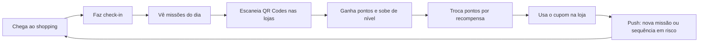

# 02 · Visão do Produto

## O problema

O shopping vê o visitante, mas não se relaciona com ele. A visita típica é **transacional**: a pessoa entra, compra o que precisava e vai embora. Não existe um motivo concreto para voltar na semana seguinte, conhecer outra ala ou passar mais tempo no local. Do lado do shopping, falta dado: quem veio, com que frequência e o que funcionou.

Os programas de fidelidade tradicionais (cartão de pontos, cadastro de notas fiscais) dão trabalho para o visitante e só recompensam quem já gasta muito.

## A proposta

**Growlithe transforma cada visita em progresso.** O visitante acumula pontos por **comportamentos que o shopping quer estimular** — circular, voltar, participar de eventos, visitar lojas novas — e não só por gastar.

| Para quem | Valor entregue |
|---|---|
| **Visitante** | Diversão (missões, níveis, sequência de visitas) + benefícios reais (desconto, estacionamento, brindes) sem cadastrar nota fiscal. |
| **Shopping (marketing)** | Canal direto com o visitante, dados de frequência e circulação, campanhas medidas em tempo real. |
| **Lojista** | Fluxo de pessoas na porta, missões patrocinadas, validação de cupom em 5 segundos. |

## Personas

**Marina, 27, frequentadora casual.** Vai ao shopping umas duas vezes por mês, geralmente para comer ou ir ao cinema. Gosta de apps com progresso visível (Duolingo, Strava). Ela *volta* se tiver uma sequência para manter e um prêmio perto de ser liberado.

**Seu Carlos, 58, aposentado.** Vai ao shopping para caminhar e tomar café. Precisa de uma interface grande, simples e sem cadastro chato. Estacionamento grátis é o prêmio que mais importa para ele.

**Juliana, gerente de marketing do shopping.** Precisa provar o retorno das campanhas. Quer criar uma missão em 2 minutos e ver quantas pessoas participaram.

**Rafael, gerente de uma loja.** Quer mais gente entrando na loja. Não quer instalar nada nem treinar a equipe: precisa validar um cupom digitando 6 dígitos.

## Ciclo de engajamento (core loop)

O **gancho de retorno** é a missão de sequência (`visit_streak`) somada à notificação "sua sequência de 3 dias termina amanhã". A **recompensa variável** vem das **Missões Relâmpago**: sorteadas, anunciadas por push, com pontos em dobro e prazo curto. Elas criam o hábito de abrir o app para "ver o que tem hoje".

## Escopo do MVP (hackathon)

**Dentro:**
- Cadastro e login por link mágico (e-mail) via Supabase Auth
- Check-in no shopping (QR Code da entrada)
- Missões dos tipos `qr_scan` (simples e caça ao tesouro), `visit_streak` e `event_checkin`
- **Missão Relâmpago de compra** (`purchase_category`): "Compre uma peça de roupa em qualquer loja nas próximas 2 horas". A compra é validada pelo **QR Code do cupom fiscal (NFC-e)**, que toda loja já imprime, sem nenhuma integração com os lojistas
- Pontos, níveis (Bronze, Prata, Ouro, Diamante) e histórico
- Catálogo de recompensas, resgate com código de 6 dígitos
- Painel admin: criar missão, gerar e imprimir QR Code, validar cupom
- **Web app** que abre pelo QR Code no navegador, sem instalar nada (decisão com o mentor, para maximizar o alcance)

**Fora (roadmap):**
- Missões de compra **em loja específica e com valor mínimo** (`purchase`): exigem consultar os itens e o valor da nota na SEFAZ (o tipo já está modelado)
- Validação do **item comprado** (e não só da categoria da loja) via consulta à SEFAZ
- Ranking social e amigos
- Notificações push nativas (no MVP, Web Push)
- Recomendação personalizada de missões

## Métricas de sucesso

| Métrica | Como medimos | Meta do piloto |
|---|---|---|
| Retorno em 7 dias | % de usuários com 2+ check-ins em 7 dias | > 30% |
| Missões por visita | scans ÷ check-ins | > 2 |
| Taxa de resgate | resgates ÷ usuários com saldo suficiente | > 40% |
| Lojas visitadas por visita | checkpoints distintos por check-in | > 3 |
