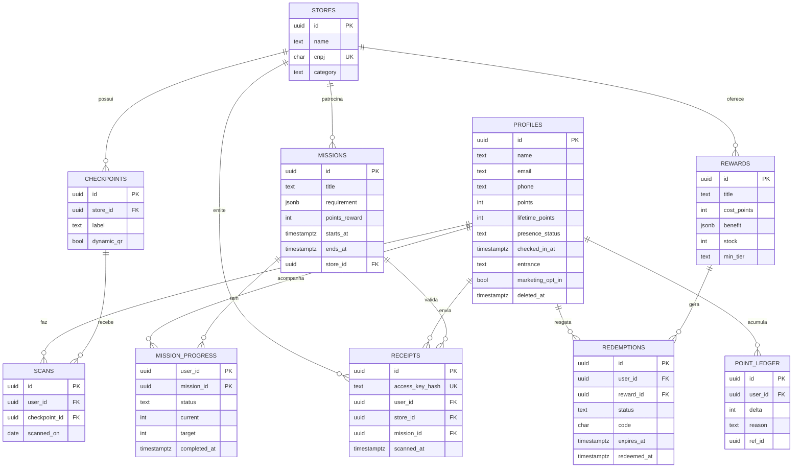
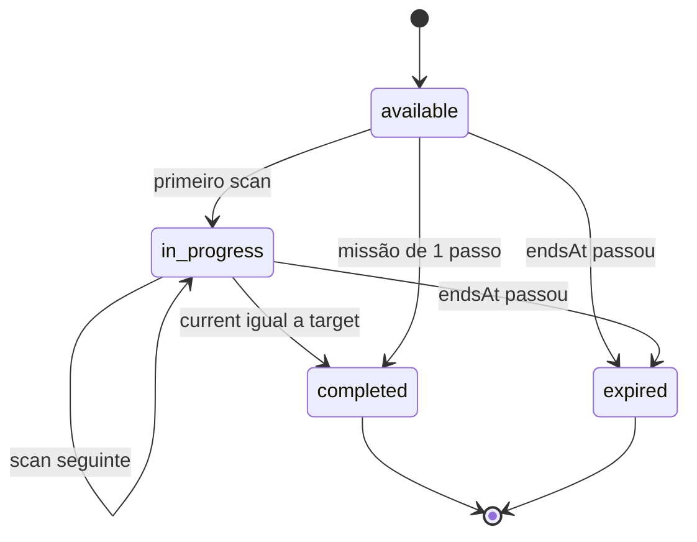
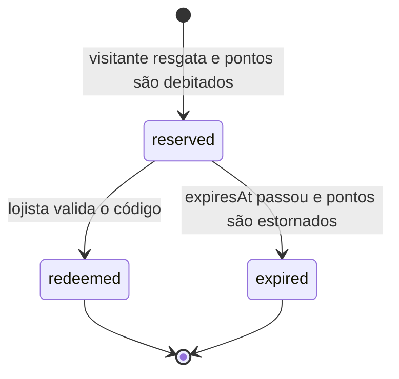

# 03 · Modelo de Dados

> **Fonte única da verdade:** [`src/domain/schemas.ts`](../src/domain/schemas.ts).
> Este documento explica as decisões. O código é o que vale, e ele **compila em `strict`** (verificado com `tsc --noEmit`, inclusive os testes de tipo em `schemas.type-test.ts`).

## Princípios

1. **Schema primeiro, tipo depois.** Todo tipo é `z.infer<typeof Schema>`. Não existe `interface User` escrita à mão.
2. **Estados inválidos não compilam.** Status vira união discriminada, nunca `boolean` + campos opcionais.
3. **Banco ≠ API.** O que está no Postgres (`User`) é diferente do que sai para o cliente (`UserDTO`). A ponte é feita com `omit`/`pick`, não com cópia manual.
4. **IDs com brand.** `UserId` e `MissionId` são `string` em runtime, mas incompatíveis entre si no compilador.
5. **Validação só na borda.** Dado que entra (formulário, QR, banco) passa por `safeParse`. Dentro do domínio, confiamos no tipo.

---

## Entidades



**Decisões de banco:**
- `point_ledger` é **append-only**: o saldo (`profiles.points`) é sempre consequência de lançamentos auditáveis. Isso é antifraude e permite estornar.
- `scans` tem `UNIQUE (user_id, checkpoint_id, scanned_on)`: o banco impede dois scans do mesmo ponto no mesmo dia, mesmo com requisições simultâneas.
- `requirement` e `benefit` são `jsonb` validados por Zod. Assim, um tipo novo de missão não exige migração.
- `receipts.access_key_hash` é `UNIQUE`: **um cupom fiscal vale uma única vez no sistema inteiro**, não só por usuário. Guardamos o hash (SHA-256) da chave, não a chave em si.
- `stores.cnpj` é `UNIQUE`: é assim que o cupom fiscal é ligado a uma loja do shopping.
- Pontos são concedidos por uma função Postgres `award_points()` (transação única: insere o scan, o lançamento e o progresso, e atualiza o saldo).

---

## 1. IDs com brand

```ts
const brandedId = <const TBrand extends string>(_brand: TBrand) =>
  z.string().uuid().brand<TBrand>();

export const UserId = brandedId("UserId");
export type UserId = z.infer<typeof UserId>;     // string & BRAND<"UserId">

export const MissionId = brandedId("MissionId");
export type MissionId = z.infer<typeof MissionId>;
```

```ts
takesMission(userId);      // ❌ UserId não é MissionId
takesMission("6f1c...");   // ❌ string crua precisa passar pelo schema
takesMission(MissionId.parse(params.id)); // ✅ única forma de obter um MissionId
```

O brand **elimina o `as`**: a única forma de criar um `MissionId` é validá-lo.

## 2. Níveis de engajamento

```ts
export const TIERS = ["bronze", "prata", "ouro", "diamante"] as const;
export const Tier = z.enum(TIERS);
export type Tier = z.infer<typeof Tier>; // "bronze" | "prata" | "ouro" | "diamante"

export const TIER_THRESHOLDS = {
  bronze: 0, prata: 500, ouro: 2_000, diamante: 5_000,
} as const satisfies Record<Tier, number>;   // esqueceu um nível? não compila.

export const tierFromPoints = (lifetimePoints: number): Tier =>
  TIERS.findLast((tier) => lifetimePoints >= TIER_THRESHOLDS[tier]) ?? "bronze";
```

O nível é **derivado** de `lifetimePoints`, nunca armazenado. Assim, não existe o estado "nível Ouro com 100 pontos".

## 3. Usuário: banco → API com Utility Types

```ts
/** Presença: `checkedInAt` só existe quando a pessoa está no shopping. */
export const Presence = z.discriminatedUnion("status", [
  z.object({ status: z.literal("away"),    lastVisitAt: z.coerce.date().nullable() }),
  z.object({ status: z.literal("at_mall"), checkedInAt: z.coerce.date(), entrance: z.string().min(1) }),
]);

/** Linha completa, como existe no banco. */
export const User = z.object({
  id: UserId,
  name: z.string().min(2).max(80),
  email: z.string().email(),
  phone: z.string().regex(/^\+55\d{10,11}$/).nullable(),
  points: z.number().int().nonnegative(),          // saldo gastável
  lifetimePoints: z.number().int().nonnegative(),  // define o nível, nunca diminui
  presence: Presence,
  marketingOptIn: z.boolean(),
  pushToken: z.string().nullable(),
  createdAt: z.coerce.date(),
  deletedAt: z.coerce.date().nullable(),
});
export type User = z.infer<typeof User>;
```

### `Omit`: o que sai do servidor

```ts
const PRIVATE_USER_FIELDS = {
  phone: true, pushToken: true, marketingOptIn: true, deletedAt: true,
} as const;

export const UserDTO = User.omit(PRIVATE_USER_FIELDS).extend({ tier: Tier });
export type UserDTO = z.infer<typeof UserDTO>;

export const toUserDTO = (user: User): UserDTO =>
  UserDTO.parse({ ...user, tier: tierFromPoints(user.lifetimePoints) });
```

`UserDTO.parse` funciona como **allow-list**: o Zod descarta chaves que não estão no schema. Mesmo que alguém espalhe `...user`, o telefone **não vaza**.

**Prova de que é o mesmo que os Utility Types do TS** (teste de tipo que roda no `tsc`):

```ts
type UserDTOWithUtilityTypes = Prettify<
  Omit<User, "phone" | "pushToken" | "marketingOptIn" | "deletedAt"> & { tier: Tier }
>;
type _dtoMatches = Expect<Equal<UserDTO, UserDTOWithUtilityTypes>>; // ✅
```

### `Pick` + `Partial`: formulário de perfil

```ts
export const UpdateProfileInput = User.pick({ name: true, phone: true, marketingOptIn: true }).partial();
export type UpdateProfileInput = z.infer<typeof UpdateProfileInput>;
// { name?: string; phone?: string | null; marketingOptIn?: boolean }
```

O usuário **não consegue** mandar `points: 999999`: o campo nem existe no tipo, e o `parse` o descarta em runtime.

## 4. Missões

### Requisito: cada tipo carrega só os seus campos

```ts
export const MissionRequirement = z.discriminatedUnion("kind", [
  z.object({ kind: z.literal("qr_scan"),       checkpointIds: z.array(CheckpointId).min(1), ordered: z.boolean() }),
  z.object({ kind: z.literal("visit_streak"),  days: z.number().int().min(2).max(30) }),
  z.object({ kind: z.literal("purchase"),      storeId: StoreId, minAmountCents: z.number().int().positive() }),
  z.object({ kind: z.literal("purchase_category"), category: StoreCategory }), // ⚡ via cupom fiscal
  z.object({ kind: z.literal("event_checkin"), checkpointId: CheckpointId, eventName: z.string().min(3) }),
]);
export type MissionKind = MissionRequirement["kind"]; // derivado: "qr_scan" | "visit_streak" | ...
```

### Missão e input de criação (`Omit` de novo)

```ts
export const Mission = z.object({
  id: MissionId,
  title: z.string().min(3).max(60),
  description: z.string().max(280),
  requirement: MissionRequirement,
  pointsReward: z.number().int().positive(),
  startsAt: z.coerce.date(),
  endsAt: z.coerce.date(),
  maxCompletionsPerUser: z.number().int().positive(),
  storeId: StoreId.nullable(),  // null = missão do próprio shopping
  launch: MissionLaunch,        // semanal ou ⚡ relâmpago (ver 6b)
  createdAt: z.coerce.date(),
});

/** O servidor gera `id` e `createdAt`; o admin não pode enviá-los. */
export const CreateMissionInput = Mission.omit({ id: true, createdAt: true }).refine(
  (m) => m.endsAt > m.startsAt,
  { message: "A missão precisa terminar depois de começar", path: ["endsAt"] },
);
```

O mesmo `CreateMissionInput` alimenta o `zodResolver` do formulário (validação no cliente) **e** a Server Action (validação no servidor). Regra escrita uma vez.

### Progresso: máquina de estados



```ts
export const MissionProgress = z.discriminatedUnion("status", [
  z.object({ status: z.literal("available"),   missionId: MissionId }),
  z.object({ status: z.literal("in_progress"), missionId: MissionId, current: z.number().int().nonnegative(), target: z.number().int().positive(), startedAt: z.coerce.date() }),
  z.object({ status: z.literal("completed"),   missionId: MissionId, completedAt: z.coerce.date(), pointsAwarded: z.number().int().positive() }),
  z.object({ status: z.literal("expired"),     missionId: MissionId, expiredAt: z.coerce.date() }),
]);

/** Extrai um membro da união pelo status — útil em filtros e props. */
export type ProgressOf<S extends MissionStatus> = Extract<MissionProgress, { status: S }>;

export const isCompleted = (p: MissionProgress): p is ProgressOf<"completed"> =>
  p.status === "completed";

const completed = progress.filter(isCompleted);
//    ^? ProgressOf<"completed">[]  → completed[0]?.pointsAwarded tem autocomplete
```

## 5. Recompensas e resgates

```ts
export const RewardBenefit = z.discriminatedUnion("kind", [
  z.object({ kind: z.literal("discount_percent"), percent: z.number().int().min(5).max(80), storeId: StoreId }),
  z.object({ kind: z.literal("discount_fixed"),   amountCents: z.number().int().positive(), storeId: StoreId }),
  z.object({ kind: z.literal("free_parking"),     hours: z.number().int().min(1).max(6) }),
  z.object({ kind: z.literal("gift"),             description: z.string().min(3), storeId: StoreId }),
]);

export const Reward = z.object({
  id: RewardId,
  title: z.string().min(3).max(60),
  costPoints: z.number().int().positive(),
  benefit: RewardBenefit,
  stock: z.number().int().nonnegative().nullable(), // null = ilimitado
  minTier: Tier,
  active: z.boolean(),
});
```



```ts
export const Redemption = z.discriminatedUnion("status", [
  RedemptionBase.extend({ status: z.literal("reserved"), code: z.string().length(6), expiresAt: z.coerce.date() }),
  RedemptionBase.extend({ status: z.literal("redeemed"), code: z.string().length(6), redeemedAt: z.coerce.date(), validatedByStoreId: StoreId.nullable() }),
  RedemptionBase.extend({ status: z.literal("expired"),  expiredAt: z.coerce.date() }),
]);
```

## 6. QR Code: o dado menos confiável do sistema

```ts
export const QrPayload = z.object({
  v: z.literal(1),           // versão do formato
  cp: CheckpointId,
  exp: z.number().int().positive(), // unix seconds
  sig: z.string().min(32),   // HMAC-SHA256(v|cp|exp, QR_SIGNING_SECRET)
});

export const ScanQrInput = z.object({ token: z.string().min(1).max(512) });
```

Detalhes da segurança em [`08-qr-code-e-gamificacao.md`](08-qr-code-e-gamificacao.md).

## 6b. Missão Relâmpago de compra + cupom fiscal (NFC-e)

**A ideia:** o shopping lança, sem aviso, uma missão genérica como *"Compre uma peça de roupa em qualquer loja nas próximas 2 horas: pontos em dobro"*. O visitante compra onde quiser e **escaneia o QR Code do cupom fiscal**.

**Por que funciona sem integrar nenhuma loja:** todo cupom fiscal de consumidor no Brasil (NFC-e, modelo 65) já sai com um QR Code impresso. O primeiro valor dentro dele é a **chave de acesso** de 44 posições, e essa chave já traz o **CNPJ da loja** e o **mês da emissão**.

```
chave = cUF(2) AAMM(4) CNPJ(14) modelo(2) série(3) número(9) tpEmis(1) código(8) DV(1)
          52    2611  12345678000195  65     001  000012345    1     12345678    7
                 │         │           │                                         │
          mês/ano emissão  │      65 = NFC-e                       dígito verificador (mód. 11)
                    loja do shopping? → stores.cnpj
```

### Loja e categoria

```ts
export const StoreCategory = z.enum(["vestuario", "calcados", "alimentacao", "beleza", /* ... */]);

export const CATEGORY_LABELS = {
  vestuario: "uma peça de roupa",
  calcados: "um calçado",
  // ...
} as const satisfies Record<StoreCategory, string>; // categoria nova sem texto = não compila

export const Store = z.object({ id: StoreId, name: z.string(), cnpj: Cnpj, category: StoreCategory, active: z.boolean() });
```

### Requisito e forma de lançamento

```ts
// novo membro da união MissionRequirement
z.object({ kind: z.literal("purchase_category"), category: StoreCategory }),

// como a missão chega ao visitante
export const MissionLaunch = z.discriminatedUnion("type", [
  z.object({ type: z.literal("scheduled") }),
  z.object({
    type: z.literal("flash"),             // Missão Relâmpago
    pushTitle: z.string().min(3).max(50),
    pushBody: z.string().min(3).max(120),
    pointsMultiplier: z.number().int().min(1).max(5),
  }),
]);
```

`purchase_category` (o **quê**) e `MissionLaunch` (o **como**) são independentes. Dá para fazer uma caça ao tesouro relâmpago ou uma missão de compra semanal, sem nenhuma combinação nova no código.

### Leitura do QR do cupom: parse em vez de validação

O schema não só valida: ele **transforma** a URL do QR em um objeto já decomposto e tipado.

```ts
export const NfceAccessKey = z
  .string()
  .regex(/^\d{6}[0-9A-Z]{12}\d{26}$/)                     // aceita CNPJ alfanumérico (jul/2026+)
  .refine((k) => accessKeyCheckDigit(k.slice(0, 43)) === Number(k.slice(43)))  // DV módulo 11
  .refine((k) => k.slice(20, 22) === "65")                 // só NFC-e
  .transform((k) => ({
    raw: k,
    uf: k.slice(0, 2),
    issuedYear: 2000 + Number(k.slice(2, 4)),
    issuedMonth: Number(k.slice(4, 6)),
    cnpj: Cnpj.parse(k.slice(6, 20)),                      // CNPJ com brand
  }));

export const NfceQrUrl = z
  .string()
  .max(1000)
  .transform((url, ctx) => {
    const key = URL.canParse(url) ? new URL(url).searchParams.get("p")?.split("|")[0] : undefined;
    if (key === undefined) {
      ctx.addIssue({ code: "custom", message: "QR não parece ser de um cupom fiscal" });
      return z.NEVER;
    }
    return key;
  })
  .pipe(NfceAccessKey);

type Parsed = z.output<typeof NfceQrUrl>;
//   ^? { raw: string; uf: string; issuedYear: number; issuedMonth: number; cnpj: Cnpj }
```

Testado com chaves geradas: QR online e de contingência, CNPJ alfanumérico, dígito adulterado (recusado), nota modelo 55 (recusada), QR que não é de cupom (recusado).

### Erros tipados

```ts
export const RECEIPT_ERRORS = [
  "invalid_receipt", "store_not_in_mall", "wrong_category",
  "receipt_already_used", "receipt_outside_window", "mission_not_active",
] as const;

export const RECEIPT_ERROR_MESSAGES = {
  invalid_receipt: "Não conseguimos ler esse cupom. Escaneie o QR Code impresso no rodapé.",
  store_not_in_mall: "Esse cupom não é de uma loja do shopping.",
  wrong_category: "Essa compra não é da categoria da missão. Confira o desafio!",
  receipt_already_used: "Esse cupom já foi usado no Growlithe.",
  receipt_outside_window: "Esse cupom é de antes do início da missão.",
  mission_not_active: "Essa missão já terminou. Fique de olho na próxima!",
} as const satisfies Record<ReceiptError, string>;
```

## 7. Contratos front ⇄ back: `Result` + `defineAction`

Erros de negócio são **valores tipados**, não exceções:

```ts
export type Result<TData, TError extends string> =
  | { ok: true; data: TData }
  | { ok: false; error: TError; message: string };

export const SCAN_ERRORS = ["invalid_qr", "expired_qr", "already_scanned_today", "mall_closed", "not_authenticated"] as const;
export type ScanError = (typeof SCAN_ERRORS)[number];

export const SCAN_ERROR_MESSAGES = {
  invalid_qr: "Esse QR Code não é do Growlithe.",
  expired_qr: "Esse QR Code expirou. Peça um novo na loja.",
  already_scanned_today: "Você já escaneou este ponto hoje. Volte amanhã!",
  mall_closed: "O shopping está fechado agora.",
  not_authenticated: "Entre na sua conta para ganhar pontos.",
} as const satisfies Record<ScanError, string>; // erro novo sem mensagem = não compila
```

A fábrica genérica de Server Actions, **zero `any`**:

```ts
export const defineAction =
  <TSchema extends z.ZodType, TData, TError extends string>(
    schema: TSchema,
    handler: (input: z.output<TSchema>) => Promise<Result<TData, TError>>,
  ) =>
  async (input: z.input<TSchema>): Promise<Result<TData, TError | "invalid_input">> => {
    const parsed = schema.safeParse(input);
    if (!parsed.success) {
      return { ok: false, error: "invalid_input", message: parsed.error.issues[0]?.message ?? "Entrada inválida" };
    }
    return handler(parsed.data);
  };
```

Uso no servidor e no cliente:

```ts
// src/server/actions/scan-qr.ts
"use server";
export const scanQr = defineAction(ScanQrInput, async ({ token }): Promise<ScanResult> => {
  //                                              ^? { token: string } — já validado
  ...
});

// componente do scanner
const result = await scanQr({ token });
if (result.ok) celebrate(result.data.pointsEarned, result.data.tierUp);
else toast(result.error === "invalid_input" ? result.message : SCAN_ERROR_MESSAGES[result.error]);
//                                                                         ^? narrowed para ScanError
```

## 8. Linha do banco → domínio (sem `as`)

O Supabase gera o tipo das tabelas (`supabase gen types typescript`). O repositório **converte a linha para o domínio passando pelo Zod**. A coluna plana vira união discriminada no caminho:

```ts
type ProfileRow = Database["public"]["Tables"]["profiles"]["Row"];

const presenceFromRow = (row: ProfileRow): unknown =>
  row.presence_status === "at_mall"
    ? { status: "at_mall", checkedInAt: row.checked_in_at, entrance: row.entrance }
    : { status: "away", lastVisitAt: row.last_visit_at };

export const userFromRow = (row: ProfileRow): User =>
  User.parse({
    id: row.id,
    name: row.name,
    email: row.email,
    phone: row.phone,
    points: row.points,
    lifetimePoints: row.lifetime_points,
    presence: presenceFromRow(row),
    marketingOptIn: row.marketing_opt_in,
    pushToken: row.push_token,
    createdAt: row.created_at,
    deletedAt: row.deleted_at,
  });
```

Se o banco tiver um dado inconsistente (por exemplo, `at_mall` sem `checked_in_at`), o erro aparece **no repositório**, com mensagem clara, e não como `undefined` na tela.

## 9. Exaustividade

```ts
export const assertNever = (value: never): never => {
  throw new Error(`Caso não tratado: ${JSON.stringify(value)}`);
};

export const benefitLabel = (b: RewardBenefit): string => {
  switch (b.kind) {
    case "discount_percent": return `${b.percent}% de desconto`;
    case "discount_fixed":   return `R$ ${(b.amountCents / 100).toFixed(2).replace(".", ",")} de desconto`;
    case "free_parking":     return `${b.hours}h de estacionamento grátis`;
    case "gift":             return b.description;
    default:                 return assertNever(b); // novo `kind`? erro aqui.
  }
};
```

## 10. Testes de tipo

[`src/domain/schemas.type-test.ts`](../src/domain/schemas.type-test.ts) roda junto com o `pnpm typecheck`. Cada `@ts-expect-error` prova que um estado inválido **não compila**:

```ts
// @ts-expect-error — "available" não tem `pointsAwarded`
const _bad1: MissionProgress = { status: "available", missionId, pointsAwarded: 10 };

// @ts-expect-error — "completed" exige `completedAt` e `pointsAwarded`
const _bad2: MissionProgress = { status: "completed", missionId };

// @ts-expect-error — cupom reservado ainda não tem `redeemedAt`
reserved.redeemedAt;
```

Se um dia esses estados passarem a compilar, o `@ts-expect-error` fica sem uso e **o build quebra**. É uma regressão detectada pelo compilador.
