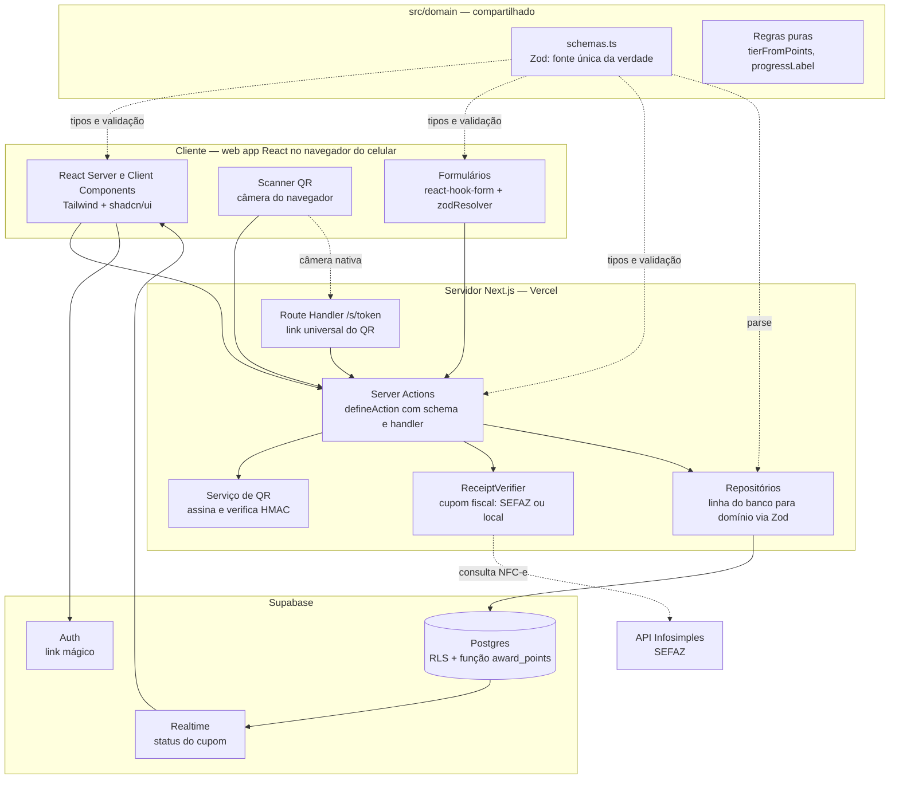
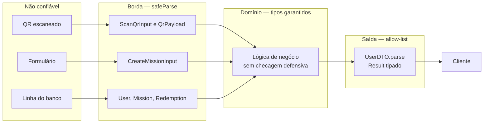
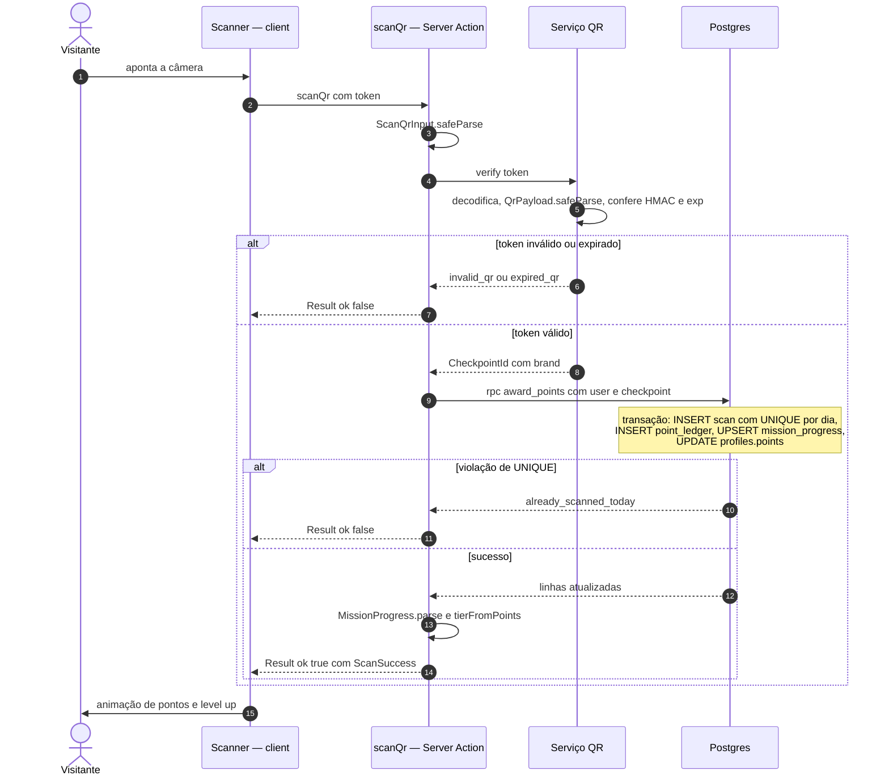
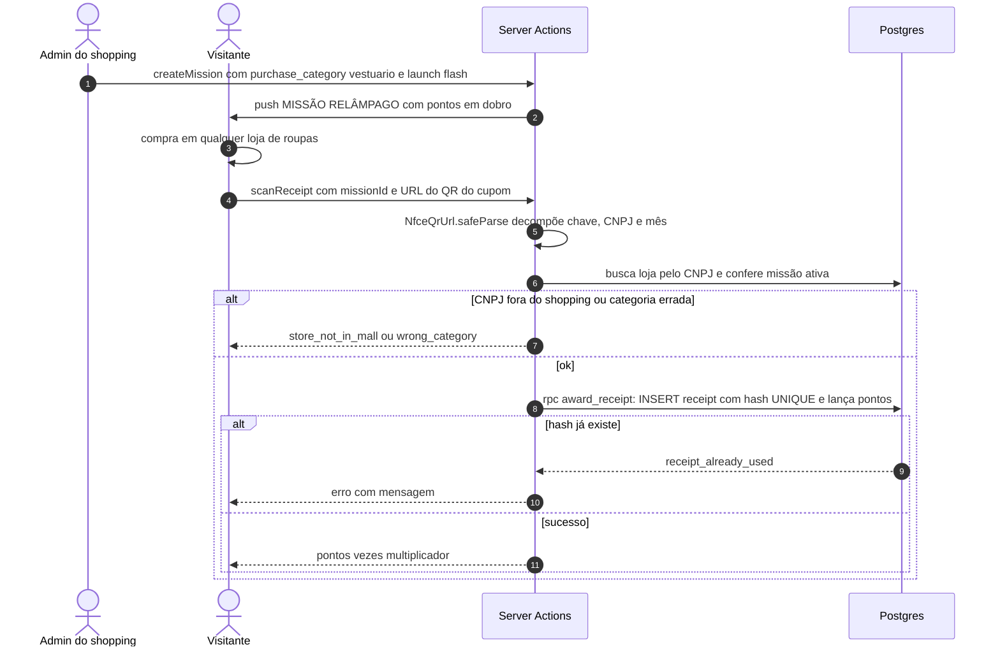
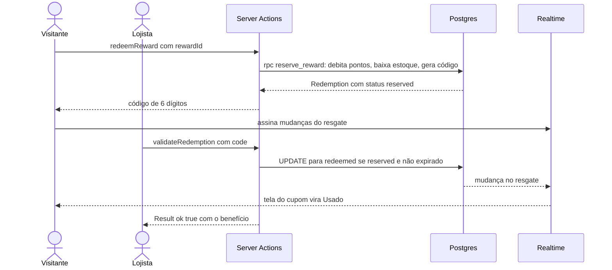

# 05 · Arquitetura Proposta

## Visão geral

Monólito modular em **Next.js (App Router)**. Um repositório e um deploy, com front-end e back-end compartilhando o mesmo domínio tipado. No hackathon, isso significa **zero tempo gasto sincronizando contratos de API**.

## Onde o tipo nasce e onde é validado

O ponto central da arquitetura: **cada fronteira de confiança tem um `parse`**, e todos os tipos vêm do mesmo lugar.

| Fronteira | Schema | O que protege |
|---|---|---|
| Câmera → servidor | `ScanQrInput`, `QrPayload` | QR forjado, expirado ou malformado |
| Formulário → servidor | `CreateMissionInput`, `UpdateProfileInput` | Admin enviando `id`; visitante tentando alterar `points` |
| Banco → domínio | `User`, `Mission`, `Redemption` | `jsonb` inconsistente, coluna nula inesperada |
| Domínio → cliente | `UserDTO` | Vazamento de telefone, token de push, flags internas |

## Fluxo crítico: escanear QR e ganhar pontos

**Por que uma função Postgres (`award_points`)?** Para atomicidade e antifraude. Dois scans simultâneos do mesmo QR não geram pontos em dobro, porque o `UNIQUE (user_id, checkpoint_id, scanned_on)` resolve no banco, não no código.

## Fluxo: Missão Relâmpago validada pelo cupom fiscal

## Fluxo: resgatar e validar cupom

## Segurança

- **RLS (Row Level Security)** em todas as tabelas: o visitante só lê o próprio `profiles`, `mission_progress` e `redemptions`.
- **Pontos nunca são escritos pelo cliente.** Só a função `award_points` (`SECURITY DEFINER`), chamada pela Server Action, altera saldo.
- **Segredo do QR** (`QR_SIGNING_SECRET`) existe só no servidor. O cliente nunca assina nada.
- **Papéis**: `visitor`, `store_staff` (valida cupons da própria loja) e `mall_admin`. O papel fica em `app_metadata` do Supabase Auth e é checado na RLS.
- **LGPD**: `UserDTO` nunca expõe dados pessoais além do nome; `marketingOptIn` é explícito; `deletedAt` permite exclusão lógica.

## Decisões arquiteturais (ADR resumido)

| # | Decisão | Alternativa descartada | Motivo |
|---|---|---|---|
| 1 | Monólito Next.js | Front e API separados | Um deploy, tipos compartilhados sem pacote extra |
| 2 | Server Actions + `defineAction` | tRPC | Mesma type-safety, zero dependência e zero boilerplate de router |
| 3 | Zod na borda + tipos gerados do Supabase | ORM (Prisma/Drizzle) | Supabase já dá tipos, Auth e RLS; menos peças em 48 h |
| 4 | **Web app** (React no navegador) | App para instalar (Kotlin, React Native) | Pedir instalação reduz o alcance (orientação do mentor). QR pela câmera abre direto no navegador; um código para Android e iPhone |
| 5 | `jsonb` + união discriminada para requisitos e benefícios | Tabela por tipo | Tipo novo de missão sem migração; validação garantida pelo Zod |
| 6 | Livro-razão de pontos (append-only) | Só a coluna de saldo | Auditoria, estorno e antifraude |
