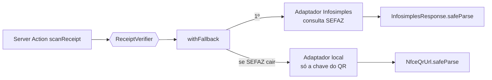

# 09 · Integração com a SEFAZ (cupom fiscal NFC-e)

## Em resumo

| Nível | Como valida | O que sabemos | Custo | Quando usar |
|---|---|---|---|---|
| **1. Local** (MVP) | Lê a chave de acesso do QR do cupom | Loja (CNPJ), mês/ano, autenticidade da chave | Zero | Sempre, e como plano B |
| **2. SEFAZ via Infosimples** (recomendado) | API consulta a nota na SEFAZ pela chave | Data e hora exatas, **valor total**, **itens comprados**, se foi **cancelada** | Pago (tem teste grátis) | Missões com valor mínimo e prêmios de alto valor |
| 3. Consulta pública direta | Abrir a URL do QR e extrair a página | O mesmo do nível 2 | Zero | Não recomendado: cada estado tem uma página diferente e alguns usam captcha |

**Recomendação:** começar no nível 1 e ligar o nível 2 com a **Infosimples**, com queda automática para o nível 1 se a consulta falhar. Assim a demo nunca quebra.

## API recomendada: Infosimples — SEFAZ / NFC-e

- Tem uma **API unificada de NFC-e** que consulta o portal da SVRS e os portais das SEFAZ estaduais e devolve um resumo da nota.
- Também há **endpoints por estado** (inclusive Tocantins, Goiás, Bahia, Rio de Janeiro, Pernambuco etc.), com versões resumida e completa.
- O parâmetro de entrada é a NFC-e. A resposta traz, entre outros: `cancelada`, `emitente` (CNPJ, nome), `informacoes_nota` (data e hora de emissão), `produtos` (nome, quantidade, valor) e o `normalizado_valor_total`.
- Os usos que ela própria cita incluem **confirmar valores, produtos e data de emissão** da nota, exatamente o que a Missão Relâmpago precisa.
- Tem **conta de teste grátis**, suficiente para a demo.

**Alternativa:** a **NFE.io** tem um recurso de consulta de cupom por chave de acesso (`consumerInvoiceQuery.retrieve(accessKey)`), com SDK oficial em Node.js. A documentação Node descreve o recurso para CF-e SAT; confirmem a cobertura de NFC-e do estado de vocês antes de escolher.

> ⚠️ Antes da demo: criar a conta de teste, consultar **um cupom real** e conferir se os nomes dos campos batem com o schema `InfosimplesNfce`. Se não baterem, o Zod falha com uma mensagem clara e o sistema cai para a validação local. Basta ajustar o schema.

## Arquitetura: porta e adaptadores

O resto do sistema só conhece a interface `ReceiptVerifier`. A troca de nível acontece em **uma linha**.



Código completo e testado em [`src/server/receipt-verifier.ts`](../src/server/receipt-verifier.ts).

### O resultado diz o quanto sabemos

```ts
export type VerifiedReceipt =
  | { source: "local"; key: NfceAccessKey }
  | { source: "sefaz"; key: NfceAccessKey; issuedAt: Date; totalCents: number; items: ReceiptItem[] };
```

Se o código tentar ler `receipt.items` sem antes checar `source === "sefaz"`, **não compila**. É impossível exibir "itens comprados" quando só fizemos a validação local.

### A resposta da API também é dado não confiável

```ts
const InfosimplesNfce = z.object({
  cancelada: z.boolean(),
  normalizado_valor_total: z.number(),
  informacoes_nota: z.object({ data_emissao: z.string(), hora_emissao: z.string() }),
  produtos: z.array(z.object({ nome: z.string(), normalizado_valor_total_produto: z.number() })),
});
const InfosimplesResponse = z.object({ code: z.number(), data: z.array(InfosimplesNfce) });
```

### Composição (uma linha)

```ts
// src/server/container.ts
export const receiptVerifier = env.INFOSIMPLES_TOKEN
  ? withFallback(createInfosimplesVerifier({ token: env.INFOSIMPLES_TOKEN, endpoint: env.INFOSIMPLES_NFCE_URL }), localVerifier)
  : localVerifier;
```

### Regra da missão nos dois níveis

```ts
checkReceiptForMission(receipt, mission)
// local → aceita se o mês/ano da chave cai na janela da missão
// sefaz → exige data e hora dentro da janela e valor ≥ mínimo
```

## Testado (fetch simulado)

| Cenário | Resultado |
|---|---|
| Nota válida, às 14h32, dentro da janela 12h–18h, R$ 129,90 | ✅ `sefaz` · aceita |
| Nota emitida às 10h, antes da missão começar | ❌ `receipt_outside_window` |
| Nota de R$ 20,00, abaixo do mínimo de R$ 50,00 | ❌ `below_minimum` |
| Nota cancelada | ❌ `receipt_canceled` |
| API devolve erro | ↩️ cai para `local` · aceita pelo mês |
| Sem internet | ↩️ cai para `local` · aceita pelo mês |

## Próximo passo habilitado: categoria pelo item

Com os `items` em mãos, a missão pode checar **o que** foi comprado, e não só a categoria da loja ("comprou uma camiseta numa loja de departamento"). Primeiro com uma lista de palavras-chave por categoria; depois, se quiserem, com um classificador de IA cuja saída também passa por `StoreCategory.safeParse`.

## LGPD

A nota pode trazer o CPF do consumidor. O Growlithe **descarta** esses campos: o schema do Zod não os inclui, e o `parse` remove o que não está no schema. Guardamos só o hash da chave, a loja, o valor e o horário.
