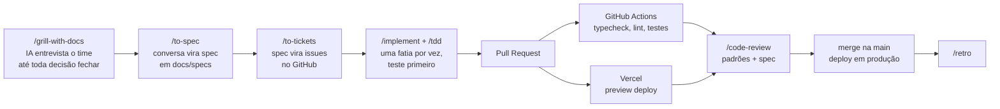

# 10 · Processo de Desenvolvimento: Spec-Driven Development

> Requisitos do professor: **skills do Matt Pocock (GitHub)**, **spec-driven development** (grill me → to spec → implement) e **GitHub + Actions + Vercel**.

## A ideia

Em vez de pedir "faz o app" para a IA e torcer, o time **decide primeiro, escreve a decisão, e só depois implementa**. A especificação (spec) é a fonte da verdade, e o código é derivado dela, do mesmo jeito que os tipos são derivados dos schemas Zod.

Usamos o conjunto de skills **`mattpocock/skills`** (licença MIT), que funciona com Claude Code, Cursor, Codex e Copilot.

## Instalação

```bash
# Claude Code
claude plugins install mattpocock-skills

# Qualquer outro agente (Cursor, Copilot, Codex...)
npx skills@latest add mattpocock/skills
```

## O fluxo do time

O fluxo principal das skills é: **grill-with-docs → to-spec → to-tickets → implement → code-review → retro**.



| Etapa | Skill | Saída | Exemplo no Growlithe |
|---|---|---|---|
| 1. Alinhar | `/grill-me` ou `/grill-with-docs` | Decisões fechadas + glossário (`CONTEXT.md`) | "Cupom de outro mês vale?" "Missão Relâmpago acumula com semanal?" |
| 2. Especificar | `/to-spec` | `docs/specs/NNN-*.md` | [`001-missao-relampago.md`](specs/001-missao-relampago.md) |
| 3. Fatiar | `/to-tickets` | Issues no GitHub com dependências | "Schema NFC-e" → "Server Action scanReceipt" → "Tela do cupom" |
| 4. Implementar | `/implement`, `/tdd` | Código + testes, uma fatia vertical por vez | `receipt-verifier.ts` + testes |
| 5. Revisar | `/code-review` | Revisão em dois eixos: padrões do repo e aderência à spec | "Usou `as`?" "Atende ao critério 4 da spec?" |
| 6. Aprender | `/retro` | O que melhorar na próxima rodada | |

`/grill-me` é a versão leve: não precisa de repositório e serve para qualquer decisão (inclusive de pitch). `/grill-with-docs` é a mesma entrevista, mas registra o glossário e as decisões em arquivos.

### Por que isso combina com o nosso modelo de dados

| Princípio SDD | Onde aparece no código |
|---|---|
| A spec é a fonte da verdade | `schemas.ts` é a fonte da verdade dos tipos |
| Critérios de aceite verificáveis | `@ts-expect-error` em `schemas.type-test.ts` + testes Vitest |
| Linguagem única (glossário) | `CONTEXT.md`: "checkpoint", "missão relâmpago", "cupom" significam a mesma coisa no código, na spec e no pitch |
| Fatias pequenas e independentes | Porta `ReceiptVerifier`: o adaptador local e o da SEFAZ são tickets separados |

## GitHub

- **Repositório:** `growlithe` (público, para a banca ver).
- **Branches:** `main` protegida; cada ticket em `feat/<nº-da-issue>-<slug>`.
- **Regra de merge:** PR com CI verde + 1 aprovação + preview da Vercel funcionando.
- **Issues:** criadas pelo `/to-tickets`, com labels `spec`, `front`, `back`, `qr`, `landing`.
- **Commits:** Conventional Commits (`feat:`, `fix:`, `docs:`).

## GitHub Actions

Arquivo: [`.github/workflows/ci.yml`](../.github/workflows/ci.yml). Roda em todo PR e em todo push na `main`:

| Job | Comando | Barra o merge se... |
|---|---|---|
| Tipos | `pnpm typecheck` | qualquer erro de tipo, inclusive um `@ts-expect-error` que deixou de ser necessário |
| Lint | `pnpm lint` | `any`, `as`, switch não exaustivo, promise solta |
| Testes | `pnpm test` | regra de negócio quebrada (níveis, cupom, janela da missão) |
| Build | `pnpm build` | o app não compila para produção |

## Vercel

- Repositório conectado à Vercel pela **integração com o GitHub**: não precisa de workflow extra.
- **Cada PR ganha uma URL de preview**: o time e o professor testam a mudança no celular antes do merge.
- **Merge na `main` = deploy em produção** (app + landing page).
- Variáveis de ambiente (`SUPABASE_*`, `QR_SIGNING_SECRET`, `INFOSIMPLES_TOKEN`) ficam no painel da Vercel, nunca no repositório.

## Rotina sugerida para o time

1. Segunda parte do hackathon começa com **uma sessão de `/grill-with-docs` de 30 min** com todo o time, sobre a feature do dia.
2. `/to-spec` → revisão rápida da spec em voz alta → `/to-tickets`.
3. Cada integrante pega um ticket, implementa com `/implement` e abre PR.
4. `/code-review` no PR do colega + preview da Vercel no celular → merge.
5. Fim do dia: `/retro` de 10 min.

> **Para estudar antes:** o vídeo do Matt Pocock mostrando o fluxo grill me → to spec → implement (indicado pelo professor) e as páginas de cada skill em aihero.dev/skills.
