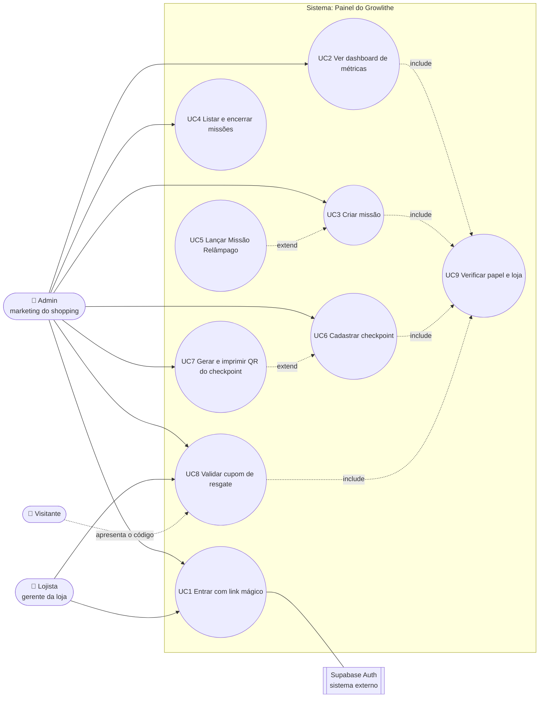
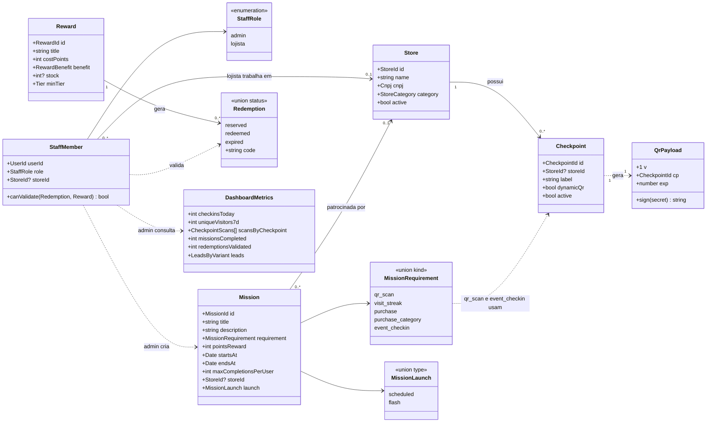

# Spec 003 · Painel do shopping (admin e lojista)

> Formato de saída do `/to-spec`. Status: **em implementação** (T1, T2 e T4 prontos) · Origem: sessão de grill de 13/11 com o time (decisões D1–D8). Telas de referência: `docs/01-telas-e-fluxos.md` (A1–A5).

## Problema

O Shopping Capim Dourado precisa **operar** o Growlithe sem depender do time de desenvolvimento: criar missões, imprimir os QR Codes dos checkpoints, ver se as ações funcionam e deixar o lojista validar o cupom de resgate no balcão. Sem o painel, não há o que escanear na demo e não há dado para mostrar à banca.

## Solução

Uma área `/painel` no mesmo projeto Next.js, responsiva (celular e desktop), com dois papéis:

- **Admin** (marketing do shopping): dashboard de métricas, missões, checkpoints e QR Codes, e validação de qualquer cupom de resgate.
- **Lojista** (gerente de loja): só valida cupom de resgate da própria loja.

O login é o mesmo link mágico do visitante. O **papel** gravado no perfil libera o painel; quem não tem papel é redirecionado.

## Decisões tomadas

| # | Pergunta | Decisão |
|---|---|---|
| D1 | Quem usa o painel? | Dois papéis: **admin** e **lojista**, com permissões diferentes |
| D2 | Como entram? | Link mágico do Supabase Auth + coluna `staff_role` no perfil. Sem senha |
| D3 | Onde funciona? | Celular e desktop (responsivo, a partir de 375px) |
| D4 | O que entra no MVP? | Dashboard, missões (criar e listar), checkpoints e QR, validar cupom de resgate |
| D5 | E o cadastro de recompensas? | Fora do MVP. 2–3 recompensas entram por **seed** no banco |
| D6 | Lojista valida cupom de resgate de outra loja? | Não. Só da própria loja. Benefício sem loja (estacionamento grátis) só o admin valida |
| D7 | Métricas do dashboard | Check-ins de hoje, visitantes únicos em 7 dias, scans por checkpoint, missões concluídas, cupons de resgate validados, leads da landing por variante A/B |
| D8 | Quem cria admin e lojista? | Seed / SQL pelo time. Tela de gestão de equipe fica para o roadmap |

## Atores

| Ator | Quem é | Persona (`docs/02`) |
|---|---|---|
| **Admin** | Marketing do shopping | Juliana |
| **Lojista** | Gerente ou caixa de uma loja | Rafael |
| **Visitante** | Apresenta o cupom de resgate no balcão (ator secundário) | Marina, Seu Carlos |
| **Supabase Auth** | Envia o link mágico (sistema externo) | — |

## Diagrama de casos de uso

| Caso de uso | Ator | Fluxo principal | Fluxos alternativos |
|---|---|---|---|
| **UC1** Entrar | Admin, Lojista | Informa o e-mail → recebe o link → abre o painel do seu papel | E-mail sem papel → tela "Você não tem acesso ao painel" com link para o app do visitante |
| **UC2** Dashboard | Admin | Vê os 6 indicadores de D7 | Sem dados ainda → estado vazio com o próximo passo ("Imprima o QR da entrada") |
| **UC3** Criar missão | Admin | Preenche o formulário A3 → missão aparece na lista e no app | Dados inválidos → erro em cada campo; fim antes do início → erro no campo "Fim" |
| **UC4** Listar e encerrar | Admin | Vê missões ativas, futuras e encerradas → encerra uma missão | — |
| **UC5** Missão Relâmpago | Admin | Escolhe lançamento "Relâmpago", título e texto do push, multiplicador | Sem título do push → erro no campo |
| **UC6** Cadastrar checkpoint | Admin | Informa nome e loja (opcional) → checkpoint criado | Nome repetido na mesma loja → erro |
| **UC7** Gerar QR | Admin | Abre o checkpoint → vê o QR assinado → imprime | — |
| **UC8** Validar cupom de resgate | Lojista, Admin | Digita os 6 dígitos → vê benefício, nome curto e nível do visitante → confirma | Código inexistente, expirado, já usado ou de outra loja → mensagem com o que fazer |
| **UC9** Verificar papel e loja | Sistema | Toda ação do servidor confere sessão, papel e loja antes de executar | Sem permissão → erro `forbidden`, nada é alterado |

## Diagrama de classes

Classes do domínio usadas pelo painel. Os tipos vêm dos schemas Zod em `src/domain/schemas.ts`; `StaffMember`, `Checkpoint` e `DashboardMetrics` são novos e entram lá no ticket T1.

## Requisitos funcionais

| ID | Requisito | Papel | Caso de uso |
|---|---|---|---|
| RF01 | O sistema deve permitir entrar no painel com link mágico enviado ao e-mail | Admin, Lojista | UC1 |
| RF02 | O sistema deve liberar o painel só para perfis com papel `admin` ou `lojista` | Sistema | UC1, UC9 |
| RF03 | O sistema deve mostrar ao lojista apenas a tela de validar cupom de resgate | Lojista | UC1 |
| RF04 | O dashboard deve exibir check-ins de hoje e visitantes únicos dos últimos 7 dias | Admin | UC2 |
| RF05 | O dashboard deve exibir o ranking de scans por checkpoint | Admin | UC2 |
| RF06 | O dashboard deve exibir missões concluídas e cupons de resgate validados | Admin | UC2 |
| RF07 | O dashboard deve exibir leads da landing e a conversão por variante A/B | Admin | UC2 |
| RF08 | O admin deve criar missão dos tipos QR Code, caça ao tesouro, sequência e evento, com pontos, período e limite por visitante | Admin | UC3 |
| RF09 | O admin deve lançar uma missão como **Missão Relâmpago**, com título e texto do push e multiplicador de 1 a 5 | Admin | UC5 |
| RF10 | O admin deve listar missões agrupadas em ativas, futuras e encerradas | Admin | UC4 |
| RF11 | O admin deve encerrar uma missão antes do fim; ela some do app do visitante na hora | Admin | UC4 |
| RF12 | O admin deve cadastrar checkpoint com nome e loja (opcional) | Admin | UC6 |
| RF13 | O sistema deve gerar o QR Code assinado (HMAC) de cada checkpoint, pronto para imprimir | Admin | UC7 |
| RF14 | O lojista e o admin devem validar um cupom de resgate digitando os 6 dígitos | Lojista, Admin | UC8 |
| RF15 | Antes de confirmar, o sistema deve mostrar o benefício, o primeiro nome e o nível do visitante | Lojista, Admin | UC8 |
| RF16 | O sistema deve recusar cupom de resgate inexistente, expirado, já usado ou de outra loja, dizendo o motivo | Sistema | UC8 |

## Requisitos não funcionais

| ID | Categoria | Requisito | Como verificamos |
|---|---|---|---|
| RNF01 | Segurança | Toda Server Action do painel confere sessão, papel e loja **no servidor**; esconder o botão não basta | Teste: lojista chamando `createMission` recebe `forbidden` |
| RNF02 | Segurança | Tabelas do painel com RLS no Supabase: lojista só lê o que é da sua loja | Teste de política RLS |
| RNF03 | Segurança | Validar um cupom de resgate é atômico: duas validações simultâneas do mesmo código confirmam uma só | Teste de concorrência na função Postgres |
| RNF04 | Segurança | O segredo de assinatura do QR (`QR_SIGNING_SECRET`) fica só no servidor e tem 32+ caracteres | Variável sem prefixo `NEXT_PUBLIC_`; validada por Zod na inicialização |
| RNF05 | Privacidade (LGPD) | O painel mostra só o primeiro nome e o nível do visitante; nunca e-mail, telefone ou CPF | Teste do DTO de validação |
| RNF06 | Confiabilidade | Toda entrada do painel é validada com Zod na borda; nenhum `any` ou `as` | CI: typecheck + lint |
| RNF07 | Desempenho | Validação de cupom de resgate responde em até 1 s; dashboard carrega em até 2 s com 10 mil scans | Medição no preview da Vercel |
| RNF08 | Usabilidade | Responsivo de 375px a 1280px, sem rolagem horizontal; alvos de toque de 44px | Teste no celular (preview) |
| RNF09 | Acessibilidade | Contraste AA nos dois temas; todo campo com rótulo visível; erro com ícone e texto, não só cor | Testes de contraste existentes + revisão |
| RNF10 | Usabilidade | Botões com verbo ("Criar missão", "Validar código"); mensagens de erro dizem o que fazer a seguir | `/code-review` |
| RNF11 | Manutenibilidade | Tipos do painel derivados de schemas Zod; switch exaustivo sobre `MissionRequirement` e `StaffRole` | CI: typecheck + lint |
| RNF12 | Auditoria | Cada validação de cupom de resgate registra quem validou (`validated_by`) e quando | Coluna obrigatória no banco |

## Critérios de aceite

Formato: **Dado** / **Quando** / **Então**. Cada critério vira pelo menos um teste.

**Acesso**
1. **Dado** um e-mail sem papel, **quando** ele abre `/painel`, **então** vê "Você não tem acesso ao painel" e nenhum dado é carregado. *(RF02)*
2. **Dado** um lojista logado, **quando** ele abre `/painel`, **então** vai direto para "Validar cupom de resgate" e não vê dashboard, missões nem checkpoints. *(RF03)*
3. **Dado** um lojista logado, **quando** ele chama a ação de criar missão direto pela API, **então** recebe `forbidden` e nada é gravado. *(RNF01)*

**Dashboard**
4. **Dado** 3 check-ins hoje de 2 visitantes, **quando** o admin abre o dashboard, **então** vê "3 check-ins hoje" e conta 2 visitantes únicos. *(RF04)*
5. **Dado** scans em 3 checkpoints, **quando** o admin abre o dashboard, **então** vê os checkpoints ordenados do mais para o menos escaneado. *(RF05)*
6. **Dado** leads nas variantes A e B, **quando** o admin abre o dashboard, **então** vê o total de leads e a conversão de cada variante. *(RF07)*
7. **Dado** um banco sem nenhum scan, **quando** o admin abre o dashboard, **então** vê um estado vazio com o próximo passo, não zeros soltos. *(UC2)*

**Missões**
8. **Dado** o formulário de missão, **quando** o admin escolhe o tipo "QR Code", **então** só os campos desse tipo aparecem (checkpoints e "em ordem?"). *(RF08)*
9. **Dado** fim antes do início, **quando** o admin tenta criar, **então** vê "A missão precisa terminar depois de começar" no campo Fim e nada é gravado. *(RF08)*
10. **Dado** uma missão válida, **quando** o admin cria, **então** ela aparece em "Ativas" (ou "Futuras") e no app do visitante dentro do período. *(RF08, RF10)*
11. **Dado** lançamento "Relâmpago" sem título do push, **quando** o admin tenta criar, **então** vê erro no campo do push. *(RF09)*
12. **Dado** uma missão ativa, **quando** o admin encerra, **então** ela vai para "Encerradas" e o visitante não consegue mais pontuar nela. *(RF11)*

**Checkpoints e QR**
13. **Dado** um checkpoint criado, **quando** o admin abre o QR, **então** o QR lido pelo scanner do app é aceito como esse checkpoint. *(RF12, RF13)*
14. **Dado** um QR com a assinatura alterada, **quando** o visitante escaneia, **então** o scan é recusado como QR inválido. *(RF13)*

**Validar cupom de resgate**
15. **Dado** um cupom de resgate reservado da loja do lojista, **quando** ele digita o código, **então** vê benefício, primeiro nome e nível do visitante antes de confirmar. *(RF14, RF15, RNF05)*
16. **Dado** que o lojista confirmou, **quando** o mesmo código é digitado de novo, **então** vê "Este cupom de resgate já foi usado" com data e hora. *(RF16)*
17. **Dado** um cupom de resgate de outra loja, **quando** o lojista digita o código, **então** vê "Este cupom de resgate é de outra loja" e nada muda. *(RF16, D6)*
18. **Dado** um cupom de resgate de estacionamento grátis, **quando** um lojista digita o código, **então** é recusado; **quando** o admin digita, **então** é aceito. *(D6)*
19. **Dado** duas confirmações simultâneas do mesmo código, **quando** as duas chegam ao servidor, **então** só uma confirma e a outra vê "já foi usado". *(RNF03)*

## Fora do escopo

- Cadastro e edição de recompensas e estoque (entram por seed — D5).
- Gestão de equipe pela tela: convidar admin ou lojista (seed/SQL — D8).
- Editar missão já criada (no MVP: encerrar e criar outra).
- Exportar relatórios.

## Tickets (`/to-tickets`)

| # | Ticket | Depende de | Issue | Status |
|---|---|---|---|---|
| T1 | Schemas `StaffRole`, `StaffMember`, `Checkpoint`, `CreateCheckpointInput`, `DashboardMetrics` + testes | — | #3 | ✅ |
| T2 | Banco: `staff_role` e `store_id` em `profiles`, tabela `checkpoints`, RLS, seed (lojas, recompensas, 1 admin, 1 lojista) | — | #4 | ✅ (falta aplicar no Supabase) |
| T3 | Login por link mágico + guarda do `/painel` por papel (critérios 1–3) | T1, T2 | #5 | ⬜ |
| T4 | Assinatura e verificação HMAC do `QrPayload` + testes (critério 14) | T1 | #6 | ✅ |
| T5 | Checkpoints: cadastrar, listar e imprimir QR (critério 13) | T3, T4 | #7 | ⬜ |
| T6 | Missões: formulário A3, lista agrupada e encerrar (critérios 8–12) | T3 | #8 | ⬜ |
| T7 | Função Postgres `validate_redemption` (atômica, com `validated_by`) + Server Action (critérios 15–19) | T2 | #9 | ⬜ |
| T8 | Tela A5 de validar cupom de resgate, responsiva | T3, T7 | #10 | ⬜ |
| T9 | Consultas e tela do dashboard (critérios 4–7) | T3; leads dependem da spec 002 T3 | #11 | ⬜ |
